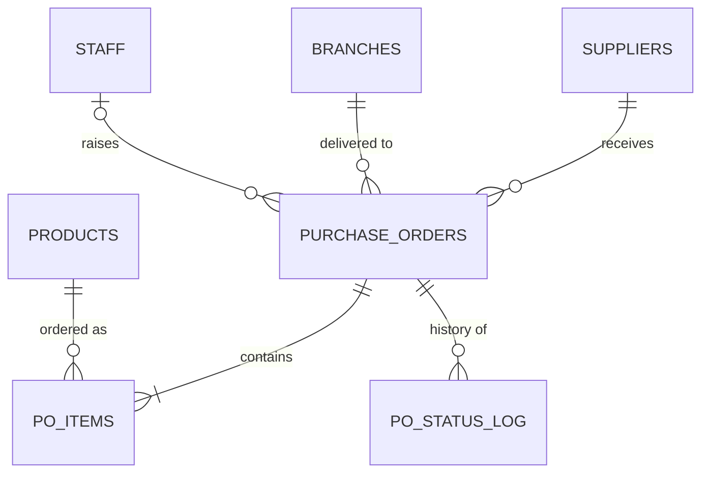

# Job 2 – Purchasing Module Design (DeshiMart, MySQL 8.0)

## 1. Conflict, assumption and question

**The conflict (two sentences in the note disagree):**
- "Every PO goes to **exactly one supplier**."
- "When a product is urgent, the buyer sometimes puts items from **two suppliers on the same PO**."

Both cannot be true. If a PO has exactly one supplier, `supplier_id` belongs on the PO header. If a PO can have two suppliers, `supplier_id` must move down to each PO line.

**Assumption I design on:** one PO = one supplier (`supplier_id` is on `purchase_orders`). An urgent order that needs two suppliers is split into **two POs**, one for each supplier. This matches the paper POs (each one shows one supplier) and keeps the delivery, status and SMS for each supplier separate.

**Question for the Purchasing Manager:**
> "When an urgent order needs items from two suppliers, can we raise two separate POs (one for each supplier)? Or must one PO really hold items from several suppliers? If so, each supplier would need its own status and delivery date on that PO."

*(Second issue I noticed: both sample POs show the same phone, 01711302214. Padma's number is a sales agent's number. CR-07 later makes phone unique, so this data must be fixed first. CR-07 gives Padma's own number, 01819554310.)*

## 2. Three-year estimate

Facts: 300 POs a month now, 12 lines on each PO, growth of 30% a year.

| Year | POs per month | POs that year | Lines that year (×12) |
|---|---|---|---|
| Year 1 | 300 | 300 × 12 = **3,600** | 43,200 |
| Year 2 | 300 × 1.3 = 390 | 390 × 12 = **4,680** | 56,160 |
| Year 3 | 390 × 1.3 = 507 | 507 × 12 = **6,084** | 73,008 |
| **Total after 3 years** | | **14,364 POs** | **172,368 PO lines** |

- At the end of year 3, the rate is 300 × 1.3³ ≈ **659 POs a month** (about 7,900 lines a month).
- Size check: 172,368 lines × about 100 bytes ≈ 17 MB, plus indexes. This is very small.

**Database type:** relational **OLTP** database (MySQL 8.0, InnoDB). We need many small inserts and updates, foreign keys and transactions.
**Design tool:** MySQL Workbench (EER Diagram / Reverse Engineer). draw.io is the backup choice. Notation: **Crow's Foot**.

## 3. Entities, attributes and relationships (ERD)

| Entity | Key attributes |
|---|---|
| SUPPLIERS | **supplier_id** (PK), supplier_name, trade_licence_no (UQ), phone, supplies |
| PURCHASE_ORDERS | **po_id** (PK), supplier_id (FK), branch_id (FK), po_date, status, expected_date → *due_date after CR-07*, raised_by (FK staff) |
| PO_ITEMS | **po_id + line_no** (PK), product_id (FK), qty_ordered, unit_cost |
| PO_STATUS_LOG | **log_id** (PK, auto), po_id (FK), old_status, new_status, changed_at |
| BRANCHES, PRODUCTS, STAFF | existing tables from the seed |

Relationships (Crow's Foot):
- SUPPLIERS 1 ──< many PURCHASE_ORDERS (each PO has exactly 1 supplier)
- BRANCHES 1 ──< many PURCHASE_ORDERS (deliver to one branch)
- STAFF 1 ──< many PURCHASE_ORDERS (raised by; optional)
- PURCHASE_ORDERS 1 ──< many PO_ITEMS (a PO has 1 or more lines)
- PRODUCTS 1 ──< many PO_ITEMS
- PURCHASE_ORDERS 1 ──< many PO_STATUS_LOG

(Draw this in Workbench / draw.io. Export it as `job2_erd.png` and also save the `.mwb` / `.drawio` file.)

## 4. Normalisation (the two sample POs)

### UNF (one flat table, repeating group of items)
| PO_No | PO_Date | Supplier | Supplies | Trade_Licence | Phone | Deliver_To | Expected | Raised_By | Status | Items (repeating) |
|---|---|---|---|---|---|---|---|---|---|---|
| PO-2026-0412 | 01-07-2026 | Shapla Agro Traders | Rice, pulses and flour | TRAD/DNCC/04417/2024 | 01711302214 | Dhanmondi | 08-07-2026 | Mahmudul Hasan (BM) | SENT | {1, GR-RIC-001, Miniket Rice 5 kg, 40, 365.00, 14,600.00} {2, GR-RIC-003, Red Lentils 1 kg, 60, 112.00, 6,720.00} |
| PO-2026-0413 | 02-07-2026 | Padma Edible Oils Ltd | Edible oils | TRAD/DSCC/11902/2023 | 01711302214 | Uttara | 06-07-2026 | Shathi Akter (BM) | SENT | {1, GR-OIL-001, Soybean Oil 5 L, 24, 790.00, 18,960.00} {2, GR-OIL-002, Mustard Oil 1 L, 36, 248.00, 8,928.00} |

### 1NF – no repeating groups, atomic values, a key
One row for each PO line. Key = **(PO_No, Line_No)**. Line_Total is removed because it is derived (qty × cost).

| PO_No | Line_No | PO_Date | Supplier | Supplies | Trade_Licence | Phone | Deliver_To | Expected | Raised_By | Status | Product_Code | Product_Name | Qty | Unit_Cost |
|---|---|---|---|---|---|---|---|---|---|---|---|---|---|---|
| PO-2026-0412 | 1 | 2026-07-01 | Shapla Agro Traders | Rice, pulses and flour | TRAD/DNCC/04417/2024 | 01711302214 | Dhanmondi | 2026-07-08 | Mahmudul Hasan | SENT | GR-RIC-001 | Miniket Rice 5 kg | 40 | 365.00 |
| PO-2026-0412 | 2 | 2026-07-01 | Shapla Agro Traders | … | … | … | Dhanmondi | 2026-07-08 | Mahmudul Hasan | SENT | GR-RIC-003 | Red Lentils 1 kg | 60 | 112.00 |
| PO-2026-0413 | 1 | 2026-07-02 | Padma Edible Oils Ltd | Edible oils | TRAD/DSCC/11902/2023 | 01711302214 | Uttara | 2026-07-06 | Shathi Akter | SENT | GR-OIL-001 | Soybean Oil 5 L | 24 | 790.00 |
| PO-2026-0413 | 2 | 2026-07-02 | Padma Edible Oils Ltd | … | … | … | Uttara | 2026-07-06 | Shathi Akter | SENT | GR-OIL-002 | Mustard Oil 1 L | 36 | 248.00 |

### 2NF – remove partial dependencies (columns that depend on only PART of the key)
PO_Date, Supplier…, Deliver_To, Expected, Raised_By and Status depend on **PO_No only**, so they move to their own table.
- **PURCHASE_ORDER**(<u>PO_No</u>, PO_Date, Supplier, Supplies, Trade_Licence, Phone, Deliver_To, Expected, Raised_By, Status)
- **PO_ITEM**(<u>PO_No, Line_No</u>, Product_Code, Product_Name, Qty, Unit_Cost)

### 3NF – remove transitive dependencies (non-key → non-key)
- Supplier name, supplies and phone depend on Trade_Licence (the supplier), not on the PO → **SUPPLIERS**
- Product_Name depends on Product_Code → existing **PRODUCTS** table
- Deliver_To (branch) → existing **BRANCHES**; Raised_By (person) → existing **STAFF**

Final 3NF tables:
- **suppliers**(<u>supplier_id</u>, supplier_name, trade_licence_no UQ, phone, supplies)
- **purchase_orders**(<u>po_id</u>, supplier_id FK, branch_id FK, po_date, status, expected_date, raised_by FK)
- **po_items**(<u>po_id, line_no</u>, product_id FK, qty_ordered, unit_cost)
- **po_status_log**(<u>log_id</u>, po_id FK, old_status, new_status, changed_at) – for the "history of every status change" requirement
- products, branches, staff – already exist

## 5. Data dictionary

| Table | Column | Type | Null | Key / Rule | Meaning |
|---|---|---|---|---|---|
| suppliers | supplier_id | INT | No | PK | Supplier number |
| | supplier_name | VARCHAR(80) | No | | Company name |
| | trade_licence_no | VARCHAR(30) | No | UNIQUE | Identifies the supplier |
| | phone | VARCHAR(15) | No | UNIQUE (after CR-07) | Phone for SMS; text type keeps the leading 0 |
| | supplies | VARCHAR(80) | Yes | | What they sell |
| purchase_orders | po_id | INT | No | PK | PO number |
| | supplier_id | INT | No | FK → suppliers | Exactly one supplier |
| | branch_id | INT | No | FK → branches | Deliver-to branch |
| | po_date | DATE | No | | Date raised |
| | status | VARCHAR(10) | No | CHECK IN (DRAFT, SENT, RECEIVED, CANCELLED), DEFAULT 'DRAFT' | PO state |
| | expected_date → **due_date** | DATE | Yes | Index with status | Expected delivery |
| | raised_by | INT | Yes | FK → staff | Who raised it |
| po_items | po_id | INT | No | PK part 1, FK → purchase_orders | |
| | line_no | INT | No | PK part 2 | Line number on the PO |
| | product_id | INT | No | FK → products | |
| | qty_ordered | INT | No | CHECK > 0 | |
| | unit_cost | DECIMAL(10,2) | No | CHECK > 0 | Agreed cost (exact money type) |
| po_status_log | log_id | INT AUTO_INCREMENT | No | PK | Made automatically |
| | po_id | INT | No | FK → purchase_orders | |
| | old_status / new_status | VARCHAR(10) | Yes / No | | Status change |
| | changed_at | DATETIME | No | DEFAULT CURRENT_TIMESTAMP | When it changed |

## 6. Reasons for the main decisions
- **DECIMAL(10,2) for money**: an exact type, so there are no rounding errors (FLOAT is not exact).
- **VARCHAR for phone and licence**: these keep the leading zeros and the "/" characters. We never do maths on them.
- **CHECK + DEFAULT on status**: only the four valid states can be stored. A new PO starts as DRAFT.
- **Composite PK (po_id, line_no)**: the spec rule. A line has no meaning without its PO.
- **No line_total column**: it is derived (`fn_line_value`). Storing it would break 3NF and could go wrong.
- **Index (status, expected_date)**: "find SENT POs by date" filters on status first, then sorts or filters by date.
- **Trigger for history**: the log is written by the database itself, so no application can forget to write it.
- **Small, simple objects**: the procedure, function and trigger are each one statement, so no `DELIMITER` is needed in Workbench.
- **CR-07 order**: (1) find the dependents, (2) fix the duplicate phone, (3) rename the column and add the UNIQUE rule, (4) rebuild the view and procedure, (5) re-test everything.
