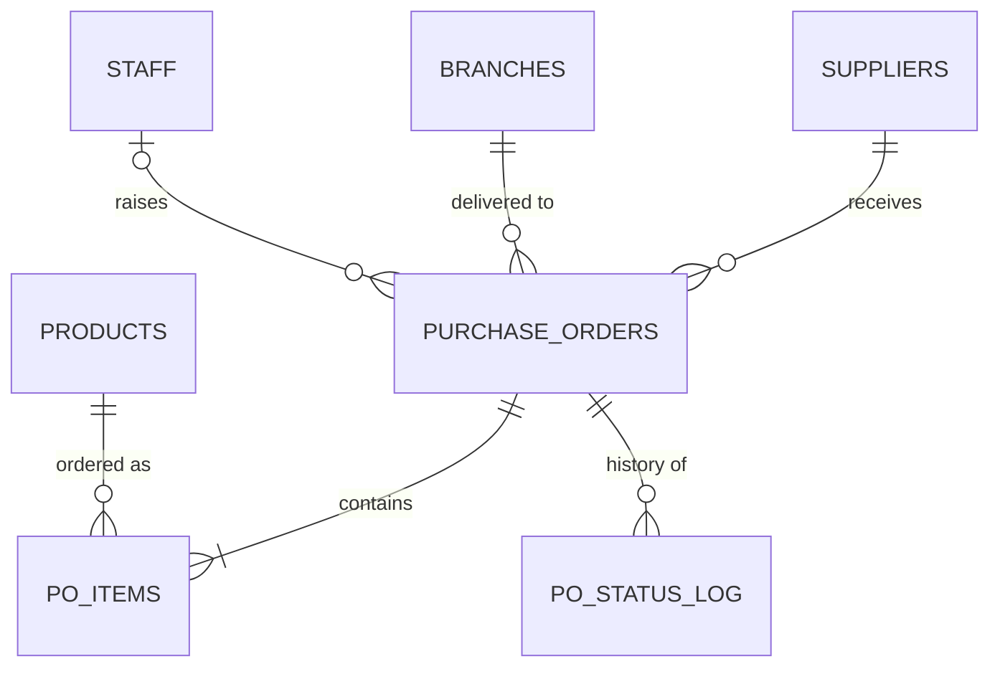
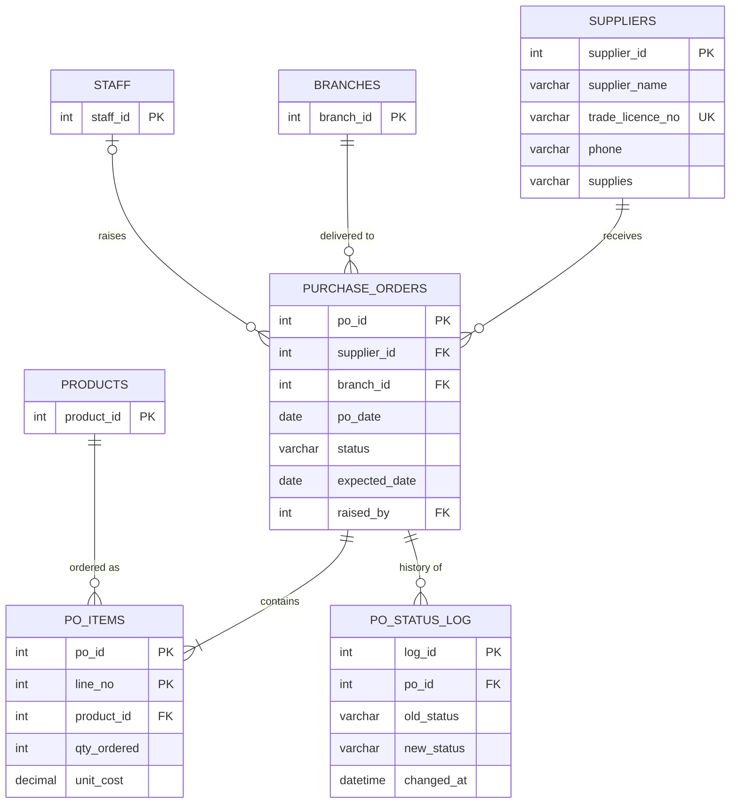
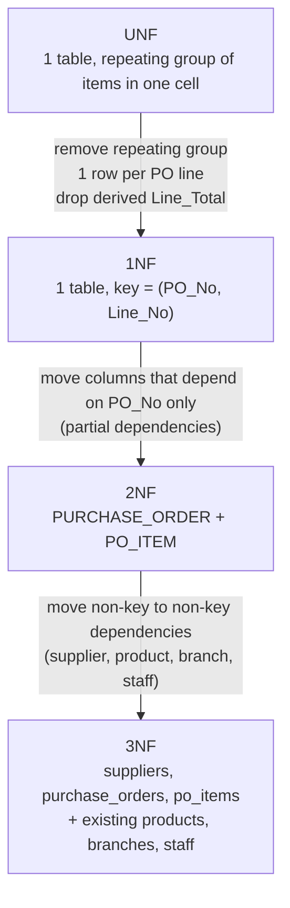
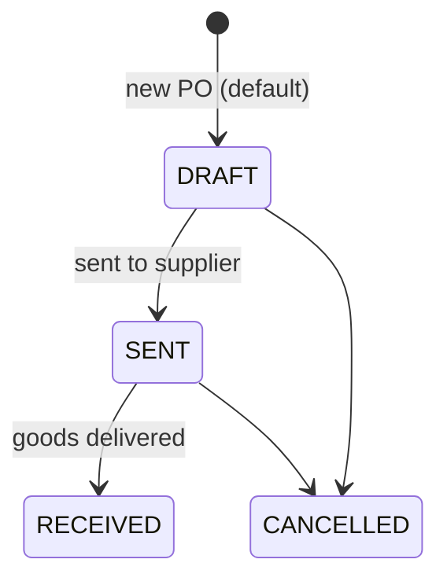

# Job 2: Purchasing Module (DeshiMart, MySQL 8.0)
## Full solution: every question explained with examples and figures

**How to read this file**

| Part | Question it answers | Section |
|---|---|---|
| A | Which two sentences conflict, what do I assume, what do I ask? | 1 |
| B | How big will the data be in 3 years, and which database and tool? | 2 |
| C | Which entities, attributes and relationships do I need (ERD)? | 3 |
| D | How do I normalise the sample POs (UNF → 1NF → 2NF → 3NF)? | 4 |
| E | What are the exact column types and rules (data dictionary)? | 5 |
| F | Why did I make each design decision? | 6 |
| G | Worked examples, SQL and exam summary | 7–9 |

---

# 0. Warm-up: the key ideas in plain words

## 0.1 What is normalisation?

Normalisation means splitting one big messy table into several small clean tables, so that **each fact is stored in exactly one place**.

```
   ONE BIG TABLE                         SEVERAL SMALL TABLES
 +--------------------+                +-----------+   +-----------+
 | PO, supplier name, |   normalise    | suppliers |<--| purchase_ |<-- po_items
 | phone, branch,     |  ----------->  +-----------+   |  orders   |
 | product, qty ...   |                | products  |   +-----------+
 +--------------------+                +-----------+
  same facts repeated                   each fact once
```

## 0.2 Vocabulary (with examples from this problem)

| Term | Meaning | Example here |
|---|---|---|
| Primary Key (PK) | Column(s) that identify one row uniquely | `po_id` |
| Composite key | A PK made of 2+ columns | `(po_id, line_no)` |
| Foreign Key (FK) | A column pointing to another table's PK | `purchase_orders.supplier_id` → `suppliers.supplier_id` |
| Functional dependency `A → B` | Knowing A tells you B for certain | `po_id → po_date` |
| Partial dependency | A column depends on only PART of a composite key | `po_date` depends on `po_id` only, not on `line_no` |
| Transitive dependency | `Key → A → B` (a non-key column depends on another non-key column) | `po_id → supplier → phone` |
| Atomic value | One value per cell, not a list | one product per row |
| Derived value | A value you can calculate from other columns | `line_total = qty × unit_cost` |

## 0.3 The three anomalies (why we bother)

Take a badly designed table where the supplier's phone is copied into every PO line.

| Anomaly | What goes wrong | Example |
|---|---|---|
| **Update** | Changing one fact needs many edits; if you miss one, data disagrees | Shapla changes phone. It appears in 50 rows. You fix 49. Now Shapla has two phones. |
| **Insert** | You cannot store a fact without an unrelated fact | You cannot record a new supplier until a PO exists for them. |
| **Delete** | Deleting one thing destroys another fact | Delete the only PO of a supplier and the supplier's details vanish. |

---

# 1. Part A: The conflict, the assumption and the question

## 1.1 The two sentences that fight each other

| # | Sentence in the note |
|---|---|
| 1 | "Every PO goes to **exactly one supplier**." |
| 2 | "When a product is urgent, the buyer sometimes puts items from **two suppliers on the same PO**." |

Both cannot be true at the same time. Sentence 1 says one supplier per PO. Sentence 2 says a PO can hold two suppliers.

## 1.2 Why it matters: where does `supplier_id` live?

```
 OPTION 1: one PO = one supplier          OPTION 2: one PO = many suppliers
 -------------------------------          ---------------------------------
 purchase_orders                          purchase_orders
 +-------+-------------+----+             +-------+----------+
 | po_id | supplier_id | .. |             | po_id | po_date  |
 +-------+-------------+----+             +-------+----------+
        | 1                                      | 1
        | has many                               | has many
        v                                        v
 po_items                                 po_items
 +-------+---------+-----+                +-------+---------+-------------+
 | po_id | line_no | ... |                | po_id | line_no | supplier_id |
 +-------+---------+-----+                +-------+---------+-------------+
 supplier_id is on the PO HEADER          supplier_id moves DOWN to each LINE
```

| | Option 1 (header) | Option 2 (line) |
|---|---|---|
| Delivery date | one per PO | would need one per supplier |
| Status (SENT, RECEIVED) | one per PO | would need one per supplier |
| SMS to supplier | one per PO | would need one per supplier |
| Complexity | Simple | Much more complex |
| Matches the paper POs? | Yes, each shows one supplier | No |

## 1.3 The assumption I design on

> **One PO = one supplier.** `supplier_id` sits on `purchase_orders`.
> An urgent order that needs two suppliers is split into **two POs**, one for each supplier.

```
 URGENT NEED: rice (Shapla) + soybean oil (Padma)

            Buyer
              |
      +-------+--------+
      v                v
  PO #A                PO #B
  supplier: Shapla     supplier: Padma
  line 1: Rice         line 1: Soybean Oil
  status: SENT         status: SENT
  SMS -> Shapla        SMS -> Padma
```

Each supplier gets its own delivery date, status and SMS, with no confusion.

## 1.4 The question I send to the Purchasing Manager

> "When an urgent order needs items from two suppliers, can we raise **two separate POs** (one for each supplier)? Or must **one PO really hold items from several suppliers**? If so, each supplier would need its own status and delivery date on that PO."

**Good practice:** when a requirement is unclear, (1) say what conflicts, (2) state the assumption you build on, (3) ask a short, clear question. Do not silently guess.

## 1.5 A second problem I noticed: a duplicate phone number

| PO | Supplier | Phone on the paper PO |
|---|---|---|
| PO-2026-0412 | Shapla Agro Traders | 01711302214 |
| PO-2026-0413 | Padma Edible Oils Ltd | **01711302214** (same!) |

The number belongs to a sales agent, not to Padma. A later change request, **CR-07**, makes `phone` **UNIQUE** and gives Padma's real number: **01819554310**. If we add UNIQUE before fixing the data, MySQL will refuse with a "duplicate entry" error. So **fix the data first, then add the rule**.

---

# 2. Part B: Three-year estimate, database type and tool

## 2.1 Given facts

- Today: **300 POs per month**
- Each PO has **12 lines**
- Growth: **30% per year**, which compounds (each year is 1.3 × the previous year)

## 2.2 Step-by-step calculation

**Step 1: monthly rate in each year**

```
Year 1 : 300
Year 2 : 300 × 1.3 = 390
Year 3 : 390 × 1.3 = 507
```

**Step 2: POs per year (× 12 months)**

```
Year 1 : 300 × 12 = 3,600
Year 2 : 390 × 12 = 4,680
Year 3 : 507 × 12 = 6,084
```

**Step 3: PO lines per year (× 12 lines per PO)**

```
Year 1 : 3,600 × 12 = 43,200
Year 2 : 4,680 × 12 = 56,160
Year 3 : 6,084 × 12 = 73,008
```

| Year | POs per month | POs that year | PO lines that year |
|---|---|---|---|
| 1 | 300 | 3,600 | 43,200 |
| 2 | 390 | 4,680 | 56,160 |
| 3 | 507 | 6,084 | 73,008 |
| **Total** | | **14,364** | **172,368** |

Check: 3,600 + 4,680 + 6,084 = 14,364, and 14,364 × 12 = 172,368. ✔

## 2.3 Figure: POs per year

```
POs per year  (each █ = 200 POs)

Year 1 | ██████████████████                  3,600
Year 2 | ███████████████████████             4,680
Year 3 | ██████████████████████████████      6,084
       +-----------------------------------------
```

## 2.4 Rate at the end of year 3

```
300 × 1.3 × 1.3 × 1.3 = 300 × 1.3³ = 300 × 2.197 ≈ 659 POs per month
659 × 12 ≈ 7,900 lines per month
```

## 2.5 How much storage is that?

```
172,368 lines × about 100 bytes per line ≈ 17,236,800 bytes ≈ 17 MB
```

Add indexes and it is still only a few tens of MB. **This is tiny for MySQL**, so there is no need for sharding or special tuning.

## 2.6 Database type: relational OLTP

| Need | Why relational OLTP (MySQL 8.0, InnoDB) fits |
|---|---|
| Many small inserts and updates (new PO, status change) | OLTP is built for short transactions |
| Links between data (PO → supplier → branch) | Foreign keys enforce them |
| "All or nothing" saving (a PO and all its lines) | InnoDB transactions |
| Rules (status must be valid, qty > 0) | CHECK, NOT NULL, UNIQUE |

OLAP / data-warehouse systems are for big reports and history analysis. That is not the main job here.

## 2.7 Design tool and notation

- **Tool:** MySQL Workbench (EER Diagram, Reverse Engineer). **Backup:** draw.io.
- **Notation:** **Crow's Foot**.
- **Deliverables:** `job2_erd.png` and the `.mwb` or `.drawio` source file.

---

# 3. Part C: Entities, attributes and relationships (ERD)

## 3.1 Entity list

| Entity | Role | Key attributes |
|---|---|---|
| **SUPPLIERS** | Who we buy from | `supplier_id` (PK), supplier_name, trade_licence_no (UNIQUE), phone, supplies |
| **PURCHASE_ORDERS** | One order to one supplier | `po_id` (PK), supplier_id (FK), branch_id (FK), po_date, status, expected_date (→ `due_date` after CR-07), raised_by (FK) |
| **PO_ITEMS** | The lines of a PO | `(po_id, line_no)` (PK), product_id (FK), qty_ordered, unit_cost |
| **PO_STATUS_LOG** | History of status changes | `log_id` (PK, auto), po_id (FK), old_status, new_status, changed_at |
| BRANCHES, PRODUCTS, STAFF | Already exist in the seed data | (existing) |

## 3.2 Relationships, in words

| Relationship | Reads as | Notes |
|---|---|---|
| SUPPLIERS 1 ──< many PURCHASE_ORDERS | One supplier receives many POs | Each PO has **exactly one** supplier (mandatory) |
| BRANCHES 1 ──< many PURCHASE_ORDERS | One branch receives many deliveries | Each PO delivers to **one** branch |
| STAFF 1 ──< many PURCHASE_ORDERS | One staff member raises many POs | `raised_by` is optional |
| PURCHASE_ORDERS 1 ──< many PO_ITEMS | One PO has **1 or more** lines | A PO with no lines makes no sense |
| PRODUCTS 1 ──< many PO_ITEMS | One product appears on many lines | |
| PURCHASE_ORDERS 1 ──< many PO_STATUS_LOG | One PO has many history rows | |

## 3.3 Crow's Foot symbols: cheat sheet

```
  ──||──   exactly one (mandatory)
  ──o|──   zero or one (optional)
  ──|<──   one or many
  ──o<──   zero or many
```

## 3.4 Figure: ERD (relationships only)



## 3.5 Figure: ERD with attributes



## 3.6 Figure: ASCII view (works anywhere)

```
 +-----------+        +------------------+        +-----------+
 | SUPPLIERS |1      *| PURCHASE_ORDERS  |*      1| BRANCHES  |
 |-----------|--------|------------------|--------|-----------|
 | supplier_id PK     | po_id PK         |
 | name, phone, ...   | supplier_id FK   |        +-----------+
 +-----------+        | branch_id FK     |*      0..1| STAFF   |
                      | raised_by FK     |---------|-----------|
                      +--------+---------+
                         1 |         | 1
                           |         |
                        1..*         *
                  +-----------+   +---------------+
                  | PO_ITEMS  |   | PO_STATUS_LOG |
                  |-----------|   |---------------|
                  | po_id,    |   | log_id PK     |
                  | line_no PK|   | po_id FK      |
                  | product_id FK +---------------+
                  +-----+-----+
                      * |
                        | 1
                  +-----+-----+
                  | PRODUCTS  |
                  +-----------+
```

---

# 4. Part D: Normalisation of the two sample POs

## 4.0 The raw data: two paper POs

**PO-2026-0412** to Shapla Agro Traders, branch Dhanmondi

| Line | Product code | Product | Qty | Unit cost | Line total |
|---|---|---|---|---|---|
| 1 | GR-RIC-001 | Miniket Rice 5 kg | 40 | 365.00 | 14,600.00 |
| 2 | GR-RIC-003 | Red Lentils 1 kg | 60 | 112.00 | 6,720.00 |

**PO-2026-0413** to Padma Edible Oils Ltd, branch Uttara

| Line | Product code | Product | Qty | Unit cost | Line total |
|---|---|---|---|---|---|
| 1 | GR-OIL-001 | Soybean Oil 5 L | 24 | 790.00 | 18,960.00 |
| 2 | GR-OIL-002 | Mustard Oil 1 L | 36 | 248.00 | 8,928.00 |

## 4.1 Figure: the normalisation journey



## 4.2 Step 0: UNF (Unnormalised Form)

All the paper data in one table. The last column holds a **list** of lines inside **one cell**.

| PO_No | PO_Date | Supplier | Supplies | Trade_Licence | Phone | Deliver_To | Expected | Raised_By | Status | Items (repeating group) |
|---|---|---|---|---|---|---|---|---|---|---|
| PO-2026-0412 | 01-07-2026 | Shapla Agro Traders | Rice, pulses and flour | TRAD/DNCC/04417/2024 | 01711302214 | Dhanmondi | 08-07-2026 | Mahmudul Hasan (BM) | SENT | {1, GR-RIC-001, Miniket Rice 5 kg, 40, 365.00, 14,600.00} {2, GR-RIC-003, Red Lentils 1 kg, 60, 112.00, 6,720.00} |
| PO-2026-0413 | 02-07-2026 | Padma Edible Oils Ltd | Edible oils | TRAD/DSCC/11902/2023 | 01711302214 | Uttara | 06-07-2026 | Shathi Akter (BM) | SENT | {1, GR-OIL-001, Soybean Oil 5 L, 24, 790.00, 18,960.00} {2, GR-OIL-002, Mustard Oil 1 L, 36, 248.00, 8,928.00} |

**What is wrong?**
- A cell holds many values. SQL cannot ask "how many times was Red Lentils ordered?"
- The number of lines varies, so how many item columns would you create?

## 4.3 Step 1: First Normal Form (1NF)

**Rules of 1NF**
1. Every cell holds **one atomic value**.
2. **No repeating groups.**
3. The table has a **primary key**.

**What I did**
- Gave each PO line **its own row**.
- Chose the key **(PO_No, Line_No)**. `PO_No` alone is not unique because PO-0412 has 2 rows.
- **Removed `Line_Total`**, because it is derived: `Qty × Unit_Cost`. (40 × 365.00 = 14,600.00, so we never need to store it.)
- Wrote dates as `YYYY-MM-DD`.

**1NF table. PK = (PO_No, Line_No)**

| PO_No | Line_No | PO_Date | Supplier | Supplies | Trade_Licence | Phone | Deliver_To | Expected | Raised_By | Status | Product_Code | Product_Name | Qty | Unit_Cost |
|---|---|---|---|---|---|---|---|---|---|---|---|---|---|---|
| PO-2026-0412 | 1 | 2026-07-01 | Shapla Agro Traders | Rice, pulses and flour | TRAD/DNCC/04417/2024 | 01711302214 | Dhanmondi | 2026-07-08 | Mahmudul Hasan | SENT | GR-RIC-001 | Miniket Rice 5 kg | 40 | 365.00 |
| PO-2026-0412 | 2 | 2026-07-01 | Shapla Agro Traders | Rice, pulses and flour | TRAD/DNCC/04417/2024 | 01711302214 | Dhanmondi | 2026-07-08 | Mahmudul Hasan | SENT | GR-RIC-003 | Red Lentils 1 kg | 60 | 112.00 |
| PO-2026-0413 | 1 | 2026-07-02 | Padma Edible Oils Ltd | Edible oils | TRAD/DSCC/11902/2023 | 01711302214 | Uttara | 2026-07-06 | Shathi Akter | SENT | GR-OIL-001 | Soybean Oil 5 L | 24 | 790.00 |
| PO-2026-0413 | 2 | 2026-07-02 | Padma Edible Oils Ltd | Edible oils | TRAD/DSCC/11902/2023 | 01711302214 | Uttara | 2026-07-06 | Shathi Akter | SENT | GR-OIL-002 | Mustard Oil 1 L | 36 | 248.00 |

**Still a problem: look at the repetition.** The first two rows repeat `PO_Date`, `Supplier`, `Phone`, `Deliver_To`, `Expected`, `Raised_By` and `Status`. This is the cause of the update, insert and delete anomalies from section 0.3.

## 4.4 Step 2: Second Normal Form (2NF)

**Rules of 2NF**
1. The table is already in 1NF.
2. **No partial dependencies.** No non-key column may depend on only PART of a composite key.

(2NF matters only when the key has 2 or more columns. Ours does: `(PO_No, Line_No)`.)

**The test.** For each column ask: *"To know this value, is PO_No alone enough, or do I also need Line_No?"*

| Column | PO_No alone enough? | Needs Line_No? | Verdict |
|---|---|---|---|
| PO_Date | Yes | No | **Partial** → move |
| Supplier, Supplies, Trade_Licence, Phone | Yes | No | **Partial** → move |
| Deliver_To | Yes | No | **Partial** → move |
| Expected | Yes | No | **Partial** → move |
| Raised_By | Yes | No | **Partial** → move |
| Status | Yes | No | **Partial** → move |
| Product_Code | No | **Yes** | Full dependency → stay |
| Product_Name | No | Yes (for now) | Full dependency → stay |
| Qty, Unit_Cost | No | **Yes** | Full dependency → stay |

**Figure: dependencies before 2NF**

```
 Key = (PO_No, Line_No)

 PO_No ---------------> PO_Date, Supplier, Phone, Deliver_To,
   |                    Expected, Raised_By, Status          <-- PARTIAL (only half the key)
   |
 PO_No + Line_No ------> Product_Code, Product_Name, Qty,
                         Unit_Cost                           <-- FULL (whole key)
```

**Solution: split into 2 tables**

**PURCHASE_ORDER. PK = PO_No** (one row per PO)

| PO_No | PO_Date | Supplier | Supplies | Trade_Licence | Phone | Deliver_To | Expected | Raised_By | Status |
|---|---|---|---|---|---|---|---|---|---|
| PO-2026-0412 | 2026-07-01 | Shapla Agro Traders | Rice, pulses and flour | TRAD/DNCC/04417/2024 | 01711302214 | Dhanmondi | 2026-07-08 | Mahmudul Hasan | SENT |
| PO-2026-0413 | 2026-07-02 | Padma Edible Oils Ltd | Edible oils | TRAD/DSCC/11902/2023 | 01711302214 | Uttara | 2026-07-06 | Shathi Akter | SENT |

**PO_ITEM. PK = (PO_No, Line_No), FK PO_No → PURCHASE_ORDER**

| PO_No | Line_No | Product_Code | Product_Name | Qty | Unit_Cost |
|---|---|---|---|---|---|
| PO-2026-0412 | 1 | GR-RIC-001 | Miniket Rice 5 kg | 40 | 365.00 |
| PO-2026-0412 | 2 | GR-RIC-003 | Red Lentils 1 kg | 60 | 112.00 |
| PO-2026-0413 | 1 | GR-OIL-001 | Soybean Oil 5 L | 24 | 790.00 |
| PO-2026-0413 | 2 | GR-OIL-002 | Mustard Oil 1 L | 36 | 248.00 |

**Improvement.** The PO date, branch and supplier are now written **once per PO**, however many lines it has.

**Still a problem.** In PURCHASE_ORDER, Shapla's phone and licence would be repeated in every Shapla PO. In PO_ITEM, the product name would be repeated on every line of that product. 3NF fixes this.

## 4.5 Step 3: Third Normal Form (3NF)

**Rules of 3NF**
1. The table is already in 2NF.
2. **No transitive dependencies.** A non-key column must not depend on another non-key column.

**One-line memory trick**

> Every column must describe **the key, the whole key, and nothing but the key.**

**Finding the chains**

| Chain | Meaning | Move to |
|---|---|---|
| `PO_No → Supplier → Supplies, Trade_Licence, Phone` | The phone describes the **supplier**, not the PO | **SUPPLIERS** (new) |
| `PO_No → Deliver_To` (branch name) | The name describes the **branch** | **BRANCHES** (existing) |
| `PO_No → Raised_By` (person name) | The name describes the **staff member** | **STAFF** (existing) |
| `(PO_No, Line_No) → Product_Code → Product_Name` | The name describes the **product** | **PRODUCTS** (existing) |

**Figure: the transitive chain (before 3NF)**

```
  PO_No ──────────► Supplier ──────────► Phone, Licence, Supplies
          direct               indirect (via the supplier)
   (PO knows its supplier)    (the supplier knows its own phone)

   Fix: PO keeps only supplier_id. Phone lives in SUPPLIERS.
```

**Final 3NF tables (with sample rows)**

`suppliers`. PK = `supplier_id`

| supplier_id | supplier_name | trade_licence_no (UNIQUE) | phone | supplies |
|---|---|---|---|---|
| 1 | Shapla Agro Traders | TRAD/DNCC/04417/2024 | 01711302214 | Rice, pulses and flour |
| 2 | Padma Edible Oils Ltd | TRAD/DSCC/11902/2023 | 01711302214 *(wrong, to be fixed to 01819554310 per CR-07)* | Edible oils |

`purchase_orders`. PK = `po_id`. FKs: `supplier_id`, `branch_id`, `raised_by`

| po_id | supplier_id | branch_id | po_date | status | expected_date | raised_by |
|---|---|---|---|---|---|---|
| 412 *(paper no. PO-2026-0412)* | 1 | id of Dhanmondi | 2026-07-01 | SENT | 2026-07-08 | id of Mahmudul Hasan |
| 413 *(paper no. PO-2026-0413)* | 2 | id of Uttara | 2026-07-02 | SENT | 2026-07-06 | id of Shathi Akter |

*(The note does not say how the paper number "PO-2026-0412" is stored. The design uses an `INT po_id`. If the business wants to keep the paper number, a UNIQUE `po_number` column can be added. That is worth confirming with the manager.)*

`po_items`. PK = `(po_id, line_no)`. FKs: `po_id`, `product_id`

| po_id | line_no | product_id | qty_ordered | unit_cost |
|---|---|---|---|---|
| 412 | 1 | id of GR-RIC-001 | 40 | 365.00 |
| 412 | 2 | id of GR-RIC-003 | 60 | 112.00 |
| 413 | 1 | id of GR-OIL-001 | 24 | 790.00 |
| 413 | 2 | id of GR-OIL-002 | 36 | 248.00 |

`po_status_log`. PK = `log_id` (auto). *This is not a result of normalisation. It exists because the requirement says "keep the history of every status change".*

| log_id | po_id | old_status | new_status | changed_at |
|---|---|---|---|---|
| 1 | 412 | DRAFT | SENT | 2026-07-01 10:30:00 |
| 2 | 413 | DRAFT | SENT | 2026-07-02 09:15:00 |

Existing tables, unchanged: `products`, `branches`, `staff`.

> **Why does `unit_cost` stay in `po_items` and not in `products`?**
> It is the **agreed price at the time of the order**. If the product's price changes next month, an old PO must still show the price that was agreed then. So `unit_cost` describes the *line*, not the product.

## 4.6 Summary table for the whole journey

| Stage | Tables | Problem solved | Problem left |
|---|---|---|---|
| UNF | 1 | none | list inside a cell |
| 1NF | 1 | repeating group removed | PO data repeated on every line |
| 2NF | 2 | PO data separated from lines | supplier, product, branch, staff data repeated |
| 3NF | 3 new + 3 existing (+ log) | each fact stored once | none (for this scope) |

## 4.7 Proof that the anomalies are gone

| Situation | In 1NF (bad) | In 3NF (good) |
|---|---|---|
| Shapla changes phone | edit every Shapla row | edit **1 row** in `suppliers` |
| New supplier, no PO yet | impossible | `INSERT` into `suppliers` |
| Delete the only PO of a supplier | supplier details lost | supplier row stays |
| Rename "Red Lentils 1 kg" | edit every line with it | edit **1 row** in `products` |

---

# 5. Part E: Data dictionary

| Table | Column | Type | Null? | Key / Rule | Meaning |
|---|---|---|---|---|---|
| **suppliers** | supplier_id | INT | No | PK | Supplier number |
| | supplier_name | VARCHAR(80) | No | | Company name |
| | trade_licence_no | VARCHAR(30) | No | UNIQUE | Identifies the supplier legally |
| | phone | VARCHAR(15) | No | UNIQUE (after CR-07) | Phone for SMS. Text keeps the leading 0 |
| | supplies | VARCHAR(80) | Yes | | What they sell |
| **purchase_orders** | po_id | INT | No | PK | PO number |
| | supplier_id | INT | No | FK → suppliers | Exactly one supplier |
| | branch_id | INT | No | FK → branches | Deliver-to branch |
| | po_date | DATE | No | | Date raised |
| | status | VARCHAR(10) | No | CHECK IN ('DRAFT','SENT','RECEIVED','CANCELLED'), DEFAULT 'DRAFT' | PO state |
| | expected_date → **due_date** | DATE | Yes | Index with status | Expected delivery (renamed by CR-07) |
| | raised_by | INT | Yes | FK → staff | Who raised it |
| **po_items** | po_id | INT | No | PK part 1, FK → purchase_orders | |
| | line_no | INT | No | PK part 2 | Line number on the PO |
| | product_id | INT | No | FK → products | |
| | qty_ordered | INT | No | CHECK > 0 | Quantity ordered |
| | unit_cost | DECIMAL(10,2) | No | CHECK > 0 | Agreed cost (exact money type) |
| **po_status_log** | log_id | INT AUTO_INCREMENT | No | PK | Made automatically |
| | po_id | INT | No | FK → purchase_orders | |
| | old_status | VARCHAR(10) | Yes | | Status before (NULL for a new PO) |
| | new_status | VARCHAR(10) | No | | Status after |
| | changed_at | DATETIME | No | DEFAULT CURRENT_TIMESTAMP | When it changed |

## 5.1 Figure: allowed PO status values

The four states come from the data dictionary. The arrows below are only an **illustration** of a typical flow, not a rule from the note.



---

# 6. Part F: Reasons for the main design decisions

| # | Decision | Reason | Example of the problem it prevents |
|---|---|---|---|
| 1 | `DECIMAL(10,2)` for money | Exact type, no rounding errors | `FLOAT` can store 0.1 + 0.2 as 0.30000000000000004 |
| 2 | `VARCHAR` for phone and licence | Keeps the leading 0 and the `/` characters. We never do maths on them | An `INT` would turn 01711302214 into 1711302214 |
| 3 | `CHECK` + `DEFAULT` on status | Only 4 valid states, and new POs start as DRAFT | Nobody can save the status "SNET" by typo |
| 4 | Composite PK `(po_id, line_no)` | A line has no meaning without its PO | Two lines cannot both be "PO 412, line 1" |
| 5 | No `line_total` column | It is derived, so storing it breaks 3NF and can go out of date | qty changed to 50 but total still says 14,600 |
| 6 | Index on `(status, expected_date)` | "Find SENT POs by date" filters status first, then date | Without it, MySQL scans the whole table |
| 7 | Trigger for history | The database writes the log itself, so no app can forget | A forgotten line of code means a missing log row |
| 8 | Small, single-statement procedure, function, trigger | No `DELIMITER` change is needed in Workbench | Fewer copy-paste errors |
| 9 | CR-07 done in a strict order | See 6.1 | Skipping a step breaks a view or fails the UNIQUE rule |

## 6.1 CR-07: the safe order


| Step | Why this position |
|---|---|
| 1 | You must know what depends on `expected_date` **before** you rename it |
| 2 | The UNIQUE rule fails while two suppliers share a phone |
| 3 | Now both changes are safe |
| 4 | Old views and procedures still mention `expected_date` |
| 5 | Prove that nothing broke |

---

# 7. Part G1: A fully worked example (an urgent two-supplier order)

**Situation.** The Uttara branch urgently needs 20 bags of Miniket Rice (Shapla) and 10 cans of Soybean Oil (Padma).

Under our assumption, the buyer raises **two POs**:

```
        URGENT NEED at Uttara
        /                    \
   PO 501                  PO 502
   supplier_id = 1 (Shapla)  supplier_id = 2 (Padma)
   line 1: Miniket Rice      line 1: Soybean Oil
```

**purchase_orders**

| po_id | supplier_id | branch_id | po_date | status | expected_date |
|---|---|---|---|---|---|
| 501 | 1 | Uttara | 2026-07-10 | DRAFT | 2026-07-12 |
| 502 | 2 | Uttara | 2026-07-10 | DRAFT | 2026-07-11 |

**po_items**

| po_id | line_no | product | qty_ordered | unit_cost | line value (derived) |
|---|---|---|---|---|---|
| 501 | 1 | GR-RIC-001 | 20 | 365.00 | 20 × 365.00 = **7,300.00** |
| 502 | 1 | GR-OIL-001 | 10 | 790.00 | 10 × 790.00 = **7,900.00** |

Now Shapla's PO can be RECEIVED on the 12th while Padma's is already RECEIVED on the 11th. Each has its own status, history and SMS. This would be impossible to model cleanly on one PO with `supplier_id` in the header.

## 7.1 Derived totals: why we calculate instead of store

Using the sample POs from section 4.0:

| PO | Line values | PO total |
|---|---|---|
| 412 | 14,600.00 + 6,720.00 | **21,320.00** |
| 413 | 18,960.00 + 8,928.00 | **27,888.00** |

These come from `SUM(qty_ordered * unit_cost)`, so they are always correct.

---

# 8. Part G2: Illustrative MySQL 8.0 code

*This is an example of how the design could be written. Table names match the data dictionary. The `branches`, `products` and `staff` tables are assumed to exist, with integer primary keys named `branch_id`, `product_id` and `staff_id`. Check these names against your seed data.*

```sql
-- 1. suppliers
CREATE TABLE suppliers (
  supplier_id      INT AUTO_INCREMENT PRIMARY KEY,
  supplier_name    VARCHAR(80) NOT NULL,
  trade_licence_no VARCHAR(30) NOT NULL UNIQUE,
  phone            VARCHAR(15) NOT NULL,   -- UNIQUE is added later by CR-07
  supplies         VARCHAR(80) NULL
);

-- 2. purchase_orders
CREATE TABLE purchase_orders (
  po_id         INT AUTO_INCREMENT PRIMARY KEY,
  supplier_id   INT NOT NULL,
  branch_id     INT NOT NULL,
  po_date       DATE NOT NULL,
  status        VARCHAR(10) NOT NULL DEFAULT 'DRAFT',
  expected_date DATE NULL,
  raised_by     INT NULL,
  CONSTRAINT chk_po_status CHECK (status IN ('DRAFT','SENT','RECEIVED','CANCELLED')),
  CONSTRAINT fk_po_supplier FOREIGN KEY (supplier_id) REFERENCES suppliers(supplier_id),
  CONSTRAINT fk_po_branch   FOREIGN KEY (branch_id)   REFERENCES branches(branch_id),
  CONSTRAINT fk_po_staff    FOREIGN KEY (raised_by)   REFERENCES staff(staff_id),
  INDEX idx_po_status_date (status, expected_date)
);

-- 3. po_items (composite PK)
CREATE TABLE po_items (
  po_id       INT NOT NULL,
  line_no     INT NOT NULL,
  product_id  INT NOT NULL,
  qty_ordered INT NOT NULL,
  unit_cost   DECIMAL(10,2) NOT NULL,
  PRIMARY KEY (po_id, line_no),
  CONSTRAINT chk_qty  CHECK (qty_ordered > 0),
  CONSTRAINT chk_cost CHECK (unit_cost > 0),
  CONSTRAINT fk_item_po      FOREIGN KEY (po_id)      REFERENCES purchase_orders(po_id),
  CONSTRAINT fk_item_product FOREIGN KEY (product_id) REFERENCES products(product_id)
);

-- 4. po_status_log
CREATE TABLE po_status_log (
  log_id     INT AUTO_INCREMENT PRIMARY KEY,
  po_id      INT NOT NULL,
  old_status VARCHAR(10) NULL,
  new_status VARCHAR(10) NOT NULL,
  changed_at DATETIME NOT NULL DEFAULT CURRENT_TIMESTAMP,
  CONSTRAINT fk_log_po FOREIGN KEY (po_id) REFERENCES purchase_orders(po_id)
);
```

**One-statement function** (no `DELIMITER` needed):

```sql
CREATE FUNCTION fn_line_value(q INT, c DECIMAL(10,2))
RETURNS DECIMAL(12,2) DETERMINISTIC
RETURN q * c;
```

**One-statement trigger** that writes the history only when the status really changes:

```sql
CREATE TRIGGER trg_po_status_log
AFTER UPDATE ON purchase_orders
FOR EACH ROW
INSERT INTO po_status_log (po_id, old_status, new_status)
SELECT OLD.po_id, OLD.status, NEW.status FROM DUAL
WHERE OLD.status <> NEW.status;
```

*(If the trigger were a plain `INSERT ... VALUES`, it would also log updates where the status did not change. The `WHERE` prevents that.)*

**Example query: PO totals** using the function:

```sql
SELECT po_id,
       SUM(fn_line_value(qty_ordered, unit_cost)) AS po_total
FROM po_items
GROUP BY po_id;
-- PO 412 -> 21320.00   PO 413 -> 27888.00
```

**CR-07 sketch** (apply in the safe order from 6.1; see your own change-request text for exact requirements):

```sql
-- step 2: fix duplicate phone
UPDATE suppliers SET phone = '01819554310'
WHERE trade_licence_no = 'TRAD/DSCC/11902/2023';

-- step 3: rename and add UNIQUE
ALTER TABLE purchase_orders RENAME COLUMN expected_date TO due_date;
ALTER TABLE suppliers ADD CONSTRAINT uq_supplier_phone UNIQUE (phone);
```

---

# 9. Part G3: Exam-style summary (what to hand in)

1. **Conflict:** "exactly one supplier per PO" versus "two suppliers on one PO".
2. **Assumption:** one PO = one supplier, with `supplier_id` in `purchase_orders`. Urgent two-supplier orders become two POs.
3. **Question:** "Can we raise two separate POs, or must one PO hold several suppliers (each then needing its own status and date)?"
4. **Extra finding:** both sample POs show phone 01711302214. Padma's own number is 01819554310. This must be fixed before CR-07 adds UNIQUE.
5. **Estimate:** 3,600 + 4,680 + 6,084 = **14,364 POs** and **172,368 lines** (about 17 MB). The year-3 rate is about 659 POs per month.
6. **Database and tool:** relational OLTP (MySQL 8.0 InnoDB). MySQL Workbench with Crow's Foot notation. Export `job2_erd.png` plus the source file.
7. **ERD:** SUPPLIERS, PURCHASE_ORDERS, PO_ITEMS, PO_STATUS_LOG, plus the existing BRANCHES, PRODUCTS and STAFF.
8. **Normalisation:** UNF → 1NF (one row per line, key `(PO_No, Line_No)`, drop line_total) → 2NF (split PO from items) → 3NF (suppliers, products, branches, staff become separate tables).
9. **Data dictionary:** DECIMAL for money, VARCHAR for phone and licence, CHECK + DEFAULT on status, composite PK on lines, index on `(status, expected_date)`.
10. **CR-07 order:** find dependents → fix duplicate phone → rename column and add UNIQUE → rebuild view and procedure → re-test.

## Quick self-test

| Question | Answer |
|---|---|
| Why is `(po_id, line_no)` the key of `po_items`? | `po_id` alone repeats for each line, and `line_no` alone repeats across POs. Together they are unique. |
| Why is `po_date` not in `po_items`? | It depends only on `po_id`, which is a partial dependency and violates 2NF. |
| Why is `phone` not in `purchase_orders`? | `po_id → supplier → phone` is a transitive dependency and violates 3NF. |
| Why no `line_total` column? | It is derived (`qty × cost`). Stored copies can become wrong. |
| Why `VARCHAR` for phone? | To keep the leading 0. We never calculate with a phone number. |
