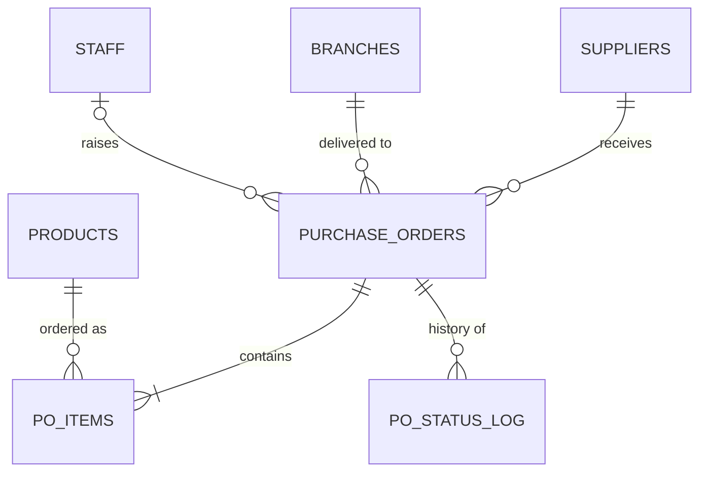

# DeshiMart – Purchasing Module: নরমালাইজেশন ধাপে ধাপে ব্যাখ্যা

> এই ফাইলে `job2_design.md`-এর সমস্যাটা একদম শুরু থেকে বোঝানো হয়েছে।
> পড়ার ক্রম: **ধারণা → UNF → 1NF → 2NF → 3NF → চূড়ান্ত টেবিল → যাচাই → বাকি অংশ (দ্বন্দ্ব, হিসাব, ERD)**।

---

## ০. সমস্যাটা আসলে কী?

DeshiMart-এর কাছে কাগজের Purchase Order (PO) আছে। প্রতিটা PO-তে থাকে:

- কোন **সরবরাহকারীর (supplier)** কাছ থেকে কেনা হচ্ছে
- কোন **শাখায় (branch)** মাল যাবে
- কে PO বানিয়েছে, তারিখ কত, অবস্থা কী (SENT ইত্যাদি)
- কয়েকটা **পণ্যের লাইন** (কোন পণ্য, কত পরিমাণ, কত দামে)

এই সবকিছু একটা বড় টেবিলে রাখলে ডাটা বারবার লেখা হয় এবং ভুল হওয়ার সুযোগ বাড়ে। **নরমালাইজেশন** হলো সেই বড় টেবিলকে ভেঙে ছোট ছোট সঠিক টেবিলে সাজানোর নিয়ম, যাতে:

1. একই তথ্য একবারই লেখা থাকে
2. পরিবর্তন করতে হলে একটা জায়গাতেই করতে হয়
3. ডাটা অসংগত (inconsistent) হয় না

---

## ১. আগে কিছু মৌলিক শব্দ

| শব্দ | সহজ অর্থ | এই সমস্যার উদাহরণ |
|---|---|---|
| **Primary Key (PK)** | যে কলাম/কলামগুলো দিয়ে প্রতিটা সারি আলাদা করে চেনা যায় | `po_id` |
| **Composite Key** | দুই বা ততোধিক কলাম মিলিয়ে বানানো PK | `(po_id, line_no)` |
| **Foreign Key (FK)** | অন্য টেবিলের PK-কে নির্দেশ করা কলাম | `purchase_orders.supplier_id → suppliers.supplier_id` |
| **Functional Dependency (A → B)** | A জানলে B নিশ্চিতভাবে জানা যায় | `Product_Code → Product_Name` |
| **Partial Dependency** | কলাম PK-এর **একটা অংশের** উপর নির্ভর করে | `PO_Date` শুধু `PO_No`-এর উপর নির্ভর করে, `Line_No`-এর উপর নয় |
| **Transitive Dependency** | Key → A → B, অর্থাৎ non-key কলাম আরেক non-key কলামের উপর নির্ভর করে | `PO_No → Supplier → Phone` |
| **Atomic value** | একটা ঘরে একটাই মান, তালিকা নয় | `{1, GR-RIC-001...} {2, ...}` ঠিক নয় |

**মনে রাখার সূত্র:**
- **1NF** = ঘর পরিষ্কার করো (একটা ঘরে একটা মান, repeating group নেই)
- **2NF** = PK-এর **অংশের** উপর নির্ভরশীল কলাম আলাদা করো
- **3NF** = non-key-এর উপর নির্ভরশীল non-key কলাম আলাদা করো

---

## ২. ধাপ ০: UNF (Unnormalised Form), মূল কাঁচা টেবিল

কাগজের দুটো নমুনা PO সরাসরি এক টেবিলে তুললে এমন দাঁড়ায়। শেষ কলামে **একাধিক আইটেম একই ঘরে** আছে। এটাই সমস্যা।

| PO_No | PO_Date | Supplier | Supplies | Trade_Licence | Phone | Deliver_To | Expected | Raised_By | Status | Items (repeating) |
|---|---|---|---|---|---|---|---|---|---|---|
| PO-2026-0412 | 01-07-2026 | Shapla Agro Traders | Rice, pulses and flour | TRAD/DNCC/04417/2024 | 01711302214 | Dhanmondi | 08-07-2026 | Mahmudul Hasan | SENT | {1, GR-RIC-001, Miniket Rice 5 kg, 40, 365.00, 14,600.00} {2, GR-RIC-003, Red Lentils 1 kg, 60, 112.00, 6,720.00} |
| PO-2026-0413 | 02-07-2026 | Padma Edible Oils Ltd | Edible oils | TRAD/DSCC/11902/2023 | 01711302214 | Uttara | 06-07-2026 | Shathi Akter | SENT | {1, GR-OIL-001, Soybean Oil 5 L, 24, 790.00, 18,960.00} {2, GR-OIL-002, Mustard Oil 1 L, 36, 248.00, 8,928.00} |

**সমস্যা কোথায়?** শেষ কলামে একটা ঘরে একাধিক লাইন আছে (repeating group)। এই টেবিলে SQL দিয়ে "Red Lentils কতবার অর্ডার হয়েছে?" বের করা প্রায় অসম্ভব।

---

## ৩. ধাপ ১: First Normal Form (1NF)

### 1NF-এর নিয়ম
1. প্রতিটা ঘরে **একটাই মান** থাকবে (atomic)
2. **Repeating group** থাকবে না
3. একটা **Primary Key** থাকবে

### কী করেছি?
- প্রতিটা **PO লাইনের জন্য আলাদা সারি** বানিয়েছি
- PK হলো **`(PO_No, Line_No)`**, কারণ শুধু PO_No দিয়ে সারি চেনা যায় না (এক PO-তে ২টা লাইন)
- **`Line_Total` বাদ** দিয়েছি, কারণ এটা হিসাব করে পাওয়া যায় (`Qty × Unit_Cost`)। হিসাব-করা মান জমিয়ে রাখলে ভুল হওয়ার সুযোগ থাকে
- তারিখ আন্তর্জাতিক ফরম্যাটে (`YYYY-MM-DD`) এনেছি

### 1NF টেবিল

**PK = (PO_No, Line_No)**

| PO_No | Line_No | PO_Date | Supplier | Supplies | Trade_Licence | Phone | Deliver_To | Expected | Raised_By | Status | Product_Code | Product_Name | Qty | Unit_Cost |
|---|---|---|---|---|---|---|---|---|---|---|---|---|---|---|
| PO-2026-0412 | 1 | 2026-07-01 | Shapla Agro Traders | Rice, pulses and flour | TRAD/DNCC/04417/2024 | 01711302214 | Dhanmondi | 2026-07-08 | Mahmudul Hasan | SENT | GR-RIC-001 | Miniket Rice 5 kg | 40 | 365.00 |
| PO-2026-0412 | 2 | 2026-07-01 | Shapla Agro Traders | Rice, pulses and flour | TRAD/DNCC/04417/2024 | 01711302214 | Dhanmondi | 2026-07-08 | Mahmudul Hasan | SENT | GR-RIC-003 | Red Lentils 1 kg | 60 | 112.00 |
| PO-2026-0413 | 1 | 2026-07-02 | Padma Edible Oils Ltd | Edible oils | TRAD/DSCC/11902/2023 | 01711302214 | Uttara | 2026-07-06 | Shathi Akter | SENT | GR-OIL-001 | Soybean Oil 5 L | 24 | 790.00 |
| PO-2026-0413 | 2 | 2026-07-02 | Padma Edible Oils Ltd | Edible oils | TRAD/DSCC/11902/2023 | 01711302214 | Uttara | 2026-07-06 | Shathi Akter | SENT | GR-OIL-002 | Mustard Oil 1 L | 36 | 248.00 |

(মূল ফাইলে "…" দিয়ে সংক্ষেপ করা ছিল। এখানে পুরো মান দেখানো হলো, যাতে **পুনরাবৃত্তি** চোখে পড়ে।)

### এখনও কী ভুল আছে? (বিশ্লেষণ)

লক্ষ্য করুন, PO-2026-0412-এর ২টা সারিতে **PO_Date, Supplier, Phone, Deliver_To... সব একই লেখা**। এটাই **redundancy (অপ্রয়োজনীয় পুনরাবৃত্তি)**। এর ফলে তিন ধরনের সমস্যা হয়:

| Anomaly | মানে | উদাহরণ |
|---|---|---|
| **Update anomaly** | একটা তথ্য বদলাতে অনেক সারি বদলাতে হয় | Shapla-র ফোন নম্বর বদলালে তাদের **সব PO লাইন** খুঁজে বদলাতে হবে। একটা বাদ গেলে একই supplier-এর দুটো ভিন্ন নম্বর থাকবে |
| **Insert anomaly** | অন্য তথ্য ছাড়া নতুন তথ্য ঢোকানো যায় না | নতুন supplier যোগ করতে চাইলে তার PO না থাকলে কোথায় রাখবেন? |
| **Delete anomaly** | একটা তথ্য মুছলে অন্য দরকারি তথ্যও মুছে যায় | কোনো supplier-এর একমাত্র PO মুছলে supplier-এর তথ্যও হারিয়ে যায় |

এগুলো ঠিক করতেই 2NF ও 3NF।

---

## ৪. ধাপ ২: Second Normal Form (2NF)

### 2NF-এর নিয়ম
1. টেবিল আগে **1NF** হতে হবে
2. কোনো non-key কলাম **PK-এর শুধু একটা অংশের উপর** নির্ভর করবে না। অর্থাৎ **partial dependency থাকবে না**

> 2NF শুধু **composite key** (একাধিক কলামের PK) থাকলে সমস্যা করে। আমাদের PK `(PO_No, Line_No)` composite, তাই এখানে প্রয়োজন।

### কোন কলাম কীসের উপর নির্ভর করে? (Dependency বিশ্লেষণ)

প্রশ্ন করুন: "এই কলামের মান জানতে **PO_No একাই** কি যথেষ্ট, নাকি **Line_No-ও** লাগবে?"

| কলাম | PO_No একাই যথেষ্ট? | Line_No লাগে? | নির্ভরতার ধরন |
|---|---|---|---|
| PO_Date | হ্যাঁ | না | **Partial** (শুধু PO_No) |
| Supplier, Supplies, Trade_Licence, Phone | হ্যাঁ | না | **Partial** |
| Deliver_To | হ্যাঁ | না | **Partial** |
| Expected | হ্যাঁ | না | **Partial** |
| Raised_By | হ্যাঁ | না | **Partial** |
| Status | হ্যাঁ | না | **Partial** |
| Product_Code | না | **হ্যাঁ** (কোন লাইন?) | Full (পুরো key) |
| Product_Name | না | হ্যাঁ | Full (আপাতত) |
| Qty, Unit_Cost | না | হ্যাঁ | Full |

(এক PO-তে সব লাইনের তারিখ, supplier, শাখা একই। তাই এগুলো PO-এর বৈশিষ্ট্য, লাইনের নয়।)

### কী করব?
Partial dependency-র কলামগুলো আলাদা টেবিলে নিয়ে যাব। যে টেবিলের PK হবে শুধু `PO_No`।

### 2NF-এর ফলাফল: ২টা টেবিল

**টেবিল ১: PURCHASE_ORDER** (PK = `PO_No`)

| PO_No | PO_Date | Supplier | Supplies | Trade_Licence | Phone | Deliver_To | Expected | Raised_By | Status |
|---|---|---|---|---|---|---|---|---|---|
| PO-2026-0412 | 2026-07-01 | Shapla Agro Traders | Rice, pulses and flour | TRAD/DNCC/04417/2024 | 01711302214 | Dhanmondi | 2026-07-08 | Mahmudul Hasan | SENT |
| PO-2026-0413 | 2026-07-02 | Padma Edible Oils Ltd | Edible oils | TRAD/DSCC/11902/2023 | 01711302214 | Uttara | 2026-07-06 | Shathi Akter | SENT |

**টেবিল ২: PO_ITEM** (PK = `(PO_No, Line_No)`, FK `PO_No → PURCHASE_ORDER`)

| PO_No | Line_No | Product_Code | Product_Name | Qty | Unit_Cost |
|---|---|---|---|---|---|
| PO-2026-0412 | 1 | GR-RIC-001 | Miniket Rice 5 kg | 40 | 365.00 |
| PO-2026-0412 | 2 | GR-RIC-003 | Red Lentils 1 kg | 60 | 112.00 |
| PO-2026-0413 | 1 | GR-OIL-001 | Soybean Oil 5 L | 24 | 790.00 |
| PO-2026-0413 | 2 | GR-OIL-002 | Mustard Oil 1 L | 36 | 248.00 |

**উন্নতি:** PO-এর তারিখ, শাখা, supplier এখন প্রতি PO-তে **একবারই** লেখা। লাইন যত বাড়ুক, এই তথ্য বাড়ে না।

**এখনও সমস্যা আছে:** PURCHASE_ORDER টেবিলে Supplier-এর নাম, Phone, Trade_Licence সবই লেখা। Padma-র যদি ১০০টা PO হয়, তাদের ফোন ১০০ বার লেখা থাকবে। এটা ঠিক করবে 3NF।

---

## ৫. ধাপ ৩: Third Normal Form (3NF)

### 3NF-এর নিয়ম
1. টেবিল আগে **2NF** হতে হবে
2. কোনো non-key কলাম আরেকটা **non-key কলামের উপর নির্ভর করবে না**। অর্থাৎ **transitive dependency থাকবে না**

> সহজ কথায়: "প্রতিটা কলাম **key সম্পর্কে, পুরো key সম্পর্কে, এবং শুধু key সম্পর্কেই** তথ্য দেবে।"

### Transitive dependency খুঁজে বের করা

PURCHASE_ORDER টেবিলে নির্ভরতার শিকল:

| শিকল | ব্যাখ্যা | কী করতে হবে |
|---|---|---|
| `PO_No → Supplier → Supplies, Phone, Trade_Licence` | PO থেকে supplier জানা যায়, আর supplier থেকে তার ফোন/লাইসেন্স জানা যায়। ফোন সরাসরি PO-এর তথ্য নয়, supplier-এর তথ্য | নতুন **SUPPLIERS** টেবিল |
| `PO_No → Deliver_To` (শাখার নাম) | শাখার নাম আসলে শাখার তথ্য | আগে থেকেই থাকা **BRANCHES** টেবিল |
| `PO_No → Raised_By` (ব্যক্তির নাম) | ব্যক্তির নাম আসলে staff-এর তথ্য | আগে থেকেই থাকা **STAFF** টেবিল |

PO_ITEM টেবিলে:

| শিকল | ব্যাখ্যা | কী করতে হবে |
|---|---|---|
| `(PO_No, Line_No) → Product_Code → Product_Name` | পণ্যের নাম নির্ভর করে পণ্যের কোডের উপর, লাইনের উপর নয় | আগে থেকেই থাকা **PRODUCTS** টেবিল |

### কী করব?
- non-key-এর উপর নির্ভরশীল কলাম আলাদা টেবিলে নেব
- মূল টেবিলে রাখব শুধু **Foreign Key** (`supplier_id`, `branch_id`, `product_id`, `raised_by`)

### 3NF-এর ফলাফল: চূড়ান্ত টেবিল

**`suppliers`** (PK = `supplier_id`)

| supplier_id | supplier_name | trade_licence_no (UQ) | phone | supplies |
|---|---|---|---|---|
| 1 | Shapla Agro Traders | TRAD/DNCC/04417/2024 | 01711302214 | Rice, pulses and flour |
| 2 | Padma Edible Oils Ltd | TRAD/DSCC/11902/2023 | 01711302214 *(ডুপ্লিকেট! §৮ দেখুন)* | Edible oils |

**`purchase_orders`** (PK = `po_id`, FK: `supplier_id`, `branch_id`, `raised_by`)

| po_id | supplier_id | branch_id | po_date | status | expected_date | raised_by |
|---|---|---|---|---|---|---|
| PO-2026-0412 | 1 | (Dhanmondi-র id) | 2026-07-01 | SENT | 2026-07-08 | (Mahmudul-এর id) |
| PO-2026-0413 | 2 | (Uttara-র id) | 2026-07-02 | SENT | 2026-07-06 | (Shathi-র id) |

**`po_items`** (PK = `(po_id, line_no)`, FK: `po_id`, `product_id`)

| po_id | line_no | product_id | qty_ordered | unit_cost |
|---|---|---|---|---|
| PO-2026-0412 | 1 | (GR-RIC-001-এর id) | 40 | 365.00 |
| PO-2026-0412 | 2 | (GR-RIC-003-এর id) | 60 | 112.00 |
| PO-2026-0413 | 1 | (GR-OIL-001-এর id) | 24 | 790.00 |
| PO-2026-0413 | 2 | (GR-OIL-002-এর id) | 36 | 248.00 |

**`po_status_log`** (PK = `log_id` অটো)
এটা নরমালাইজেশনের ফল নয়। এটা আলাদা **প্রয়োজনের** জন্য: "প্রতিটা status বদলের ইতিহাস রাখতে হবে।"

| log_id | po_id | old_status | new_status | changed_at |
|---|---|---|---|---|
| 1 | PO-2026-0412 | DRAFT | SENT | 2026-07-01 10:30:00 |

**আগে থেকেই থাকা টেবিল:** `products`, `branches`, `staff` (seed ডাটা থেকে)।

> **`unit_cost` কেন `po_items`-এ রইল, products-এ গেল না?**
> কারণ এটা PO করার **সময়ের চুক্তিবদ্ধ দাম**। পণ্যের দাম পরে বদলালেও পুরোনো PO-র দাম বদলানো চলবে না। তাই এটা লাইনেরই তথ্য।

---

## ৬. পুরো যাত্রা এক নজরে

| ধাপ | সমস্যা | সমাধান | ফল |
|---|---|---|---|
| **UNF** | এক ঘরে একাধিক আইটেম | কিছু না, এটাই শুরু | ১টা অগোছালো টেবিল |
| **1NF** | Repeating group | প্রতি লাইনে ১টা সারি, PK = `(PO_No, Line_No)` | ১টা টেবিল (অনেক পুনরাবৃত্তি) |
| **2NF** | Partial dependency (PO-র তথ্য লাইনের সাথে লেখা) | PO-র তথ্য আলাদা টেবিলে | ২টা টেবিল |
| **3NF** | Transitive dependency (supplier, product, branch, staff-এর তথ্য ঢোকানো) | প্রতিটার নিজস্ব টেবিল, শুধু FK রাখা | `suppliers`, `purchase_orders`, `po_items` + পুরোনো টেবিল |

---

## ৭. যাচাই: Anomaly কি সত্যিই দূর হলো?

| আগে (1NF) | এখন (3NF) |
|---|---|
| Shapla-র ফোন বদলাতে সব PO লাইনে বদলাতে হতো | `suppliers`-এ **১টা সারিতে** বদলালেই হয় |
| PO ছাড়া নতুন supplier রাখা যেত না | `suppliers`-এ সরাসরি ঢোকানো যায় |
| একমাত্র PO মুছলে supplier-এর তথ্য হারাত | PO মুছলেও supplier টেবিলে থেকে যায় |
| পণ্যের নাম বদলালে অনেক সারি বদলাতে হতো | `products`-এ ১টা সারি |

---

## ৮. ডাটার ভুল: Padma-র ফোন নম্বর

দুটো নমুনা PO-তেই ফোন **01711302214**। কিন্তু এটা আসলে **Shapla-র sales agent-এর** নম্বর। CR-07 (পরবর্তী পরিবর্তন) অনুযায়ী `phone` **UNIQUE** হবে এবং Padma-র নিজের নম্বর **01819554310**।

তাই UNIQUE নিয়ম যোগ করার **আগে** Padma-র নম্বর ঠিক করতে হবে। নইলে `ALTER TABLE` ব্যর্থ হবে (duplicate entry)।

---

## ৯. মূল দ্বন্দ্ব: একটা PO-তে কয়টা supplier?

নোটের দুটো বাক্য পরস্পরবিরোধী:

1. "প্রতিটা PO **ঠিক একটা** supplier-এর কাছে যায়।"
2. "জরুরি হলে একই PO-তে **দুই** supplier-এর আইটেম রাখা হয়।"

| ধরে নিলে | `supplier_id` কোথায় বসবে | ফল |
|---|---|---|
| ১ PO = ১ supplier | **`purchase_orders`** (header-এ) | সহজ ডিজাইন, প্রতি supplier-এর আলাদা status ও SMS |
| ১ PO-তে একাধিক supplier | **`po_items`** (প্রতি লাইনে) | status, delivery date, SMS সব supplier-ভিত্তিক করতে হবে, জটিল |

**আমার সিদ্ধান্ত:** ১ PO = ১ supplier ধরে ডিজাইন। জরুরি অর্ডারে দুই supplier লাগলে **২টা আলাদা PO** হবে। কাগজের PO-তেও একটাই supplier দেখা যায়।

**ম্যানেজারকে প্রশ্ন:**
> "জরুরি অর্ডারে দুই supplier লাগলে কি আমরা দুটো আলাদা PO করতে পারি? নাকি একটা PO-তেই একাধিক supplier থাকতেই হবে? তাহলে প্রতিটা supplier-এর আলাদা status ও delivery date লাগবে।"

ভালো অভ্যাস: অনুমান করলে সেটা **লিখে রাখুন** এবং **প্রশ্ন করুন**। সন্দেহ গোপন রাখা ভুল।

---

## ১০. ERD (সম্পর্কের নকশা)

**Crow's Foot চিহ্ন পড়ার নিয়ম:**

| চিহ্ন | মানে |
|---|---|
| `\|\|` | ঠিক ১টা (বাধ্যতামূলক) |
| `o\|` | ০ বা ১টা (ঐচ্ছিক) |
| `o{` | ০ বা অনেক |
| `\|{` | ১ বা অনেক |

**সম্পর্কগুলো বাংলায়:**
- ১ supplier-এর **অনেক** PO থাকতে পারে; প্রতিটা PO-র **ঠিক ১** supplier
- ১ PO-তে **১ বা তার বেশি** লাইন থাকবে (লাইন ছাড়া PO অর্থহীন)
- ১ product **অনেক** PO লাইনে আসতে পারে
- ১ PO-র **অনেক** status-log থাকতে পারে
- `raised_by` ঐচ্ছিক (staff না-ও থাকতে পারে)

---

## ১১. তিন বছরের আকার-অনুমান (হিসাবটা বোঝা)

**তথ্য:** মাসে ৩০০ PO, প্রতি PO-তে ১২ লাইন, বছরে ৩০% বৃদ্ধি।

| বছর | মাসে PO | বছরে PO | বছরে লাইন (×১২) |
|---|---|---|---|
| ১ম | ৩০০ | ৩০০ × ১২ = **৩,৬০০** | ৪৩,২০০ |
| ২য় | ৩০০ × ১.৩ = ৩৯০ | ৩৯০ × ১২ = **৪,৬৮০** | ৫৬,১৬০ |
| ৩য় | ৩৯০ × ১.৩ = ৫০৭ | ৫০৭ × ১২ = **৬,০৮৪** | ৭৩,০০৮ |
| **মোট** | | **১৪,৩৬৪ PO** | **১,৭২,৩৬৮ লাইন** |

- ৩য় বছরের শেষে মাসে ≈ 300 × 1.3³ ≈ **৬৫৯ PO**
- আকার: ১,৭২,৩৬৮ × ~১০০ বাইট ≈ **১৭ MB** (index বাদে)। এটা MySQL-এর জন্য খুবই ছোট।

**ডাটাবেসের ধরন:** Relational **OLTP** (MySQL 8.0, InnoDB), কারণ অনেক ছোট insert/update, foreign key ও transaction লাগে।

---

## ১২. Data Dictionary-র সিদ্ধান্তগুলোর কারণ

| সিদ্ধান্ত | কারণ |
|---|---|
| `DECIMAL(10,2)` টাকার জন্য | সঠিক (exact) টাইপ। `FLOAT` এ রাউন্ডিং ভুল হয় |
| `VARCHAR` ফোন ও লাইসেন্সে | শুরুর `0` ও `/` চিহ্ন থাকে। এগুলো দিয়ে অঙ্ক কষা হয় না |
| `status`-এ CHECK + DEFAULT | শুধু DRAFT/SENT/RECEIVED/CANCELLED রাখা যাবে, নতুন PO শুরু হবে DRAFT দিয়ে |
| `(po_id, line_no)` composite PK | লাইন তার PO ছাড়া অর্থহীন |
| `line_total` কলাম নেই | derived মান। রাখলে 3NF ভাঙে এবং ভুল হতে পারে (`fn_line_value` দিয়ে হিসাব) |
| Index `(status, expected_date)` | "SENT অবস্থার PO তারিখ অনুযায়ী খোঁজা" — আগে status, পরে date দিয়ে ফিল্টার |
| Trigger দিয়ে history | ডাটাবেস নিজেই লগ লেখে, কোনো অ্যাপ ভুলে যেতে পারে না |
| ছোট object, `DELIMITER` লাগে না | procedure/function/trigger প্রতিটা এক স্টেটমেন্টের, Workbench-এ সহজ |

**CR-07 পরিবর্তনের সঠিক ক্রম:**
1. কে কে এই কলামের উপর নির্ভরশীল খুঁজে বের করো (view, procedure)
2. ডুপ্লিকেট ফোন ঠিক করো
3. কলামের নাম বদলাও (`expected_date → due_date`) ও UNIQUE নিয়ম যোগ করো
4. view ও procedure নতুন করে বানাও
5. সবকিছু আবার টেস্ট করো

---

## ১৩. নিজে যাচাই করার চেকলিস্ট

প্রতিটা টেবিলের জন্য এই প্রশ্নগুলো করুন:

- [ ] প্রতিটা ঘরে একটাই মান আছে? **(1NF)**
- [ ] PK আছে? **(1NF)**
- [ ] composite key হলে, কোনো কলাম key-এর শুধু অংশের উপর নির্ভর করছে? থাকলে আলাদা করো **(2NF)**
- [ ] কোনো non-key কলাম অন্য non-key কলামের উপর নির্ভর করছে? থাকলে আলাদা করো **(3NF)**
- [ ] derived (হিসাব করা) মান জমানো হয়নি তো?

**৩NF-এর এক লাইনের সূত্র:**
> "The key, the whole key, and nothing but the key — so help me Codd."

---

## ১৪. সংক্ষেপে মূল কথা

1. কাগজের PO-র সব তথ্য এক টেবিলে রাখলে পুনরাবৃত্তি ও ভুলের সুযোগ হয়
2. **1NF** দিয়ে লাইনগুলো আলাদা সারি করা হয়
3. **2NF** দিয়ে PO-র সাধারণ তথ্য লাইন থেকে আলাদা করা হয়
4. **3NF** দিয়ে supplier, product, branch, staff-এর তথ্য নিজ নিজ টেবিলে পাঠানো হয়
5. চূড়ান্ত ডিজাইন: `suppliers`, `purchase_orders`, `po_items`, `po_status_log` (+ পুরোনো `products`, `branches`, `staff`)
6. মূল অনুমান: **১ PO = ১ supplier**। এ নিয়ে ম্যানেজারকে প্রশ্ন করতে হবে
7. Padma-র ফোন নম্বরের ডাটা ভুল, UNIQUE নিয়মের আগে সংশোধন করতে হবে
