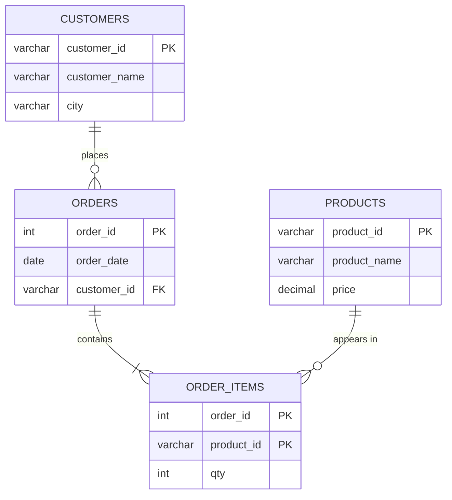
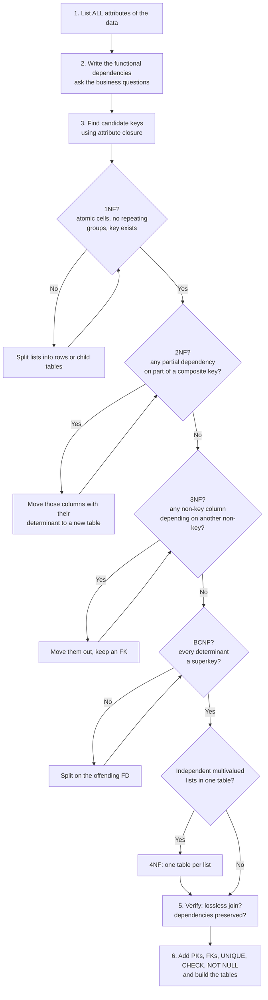
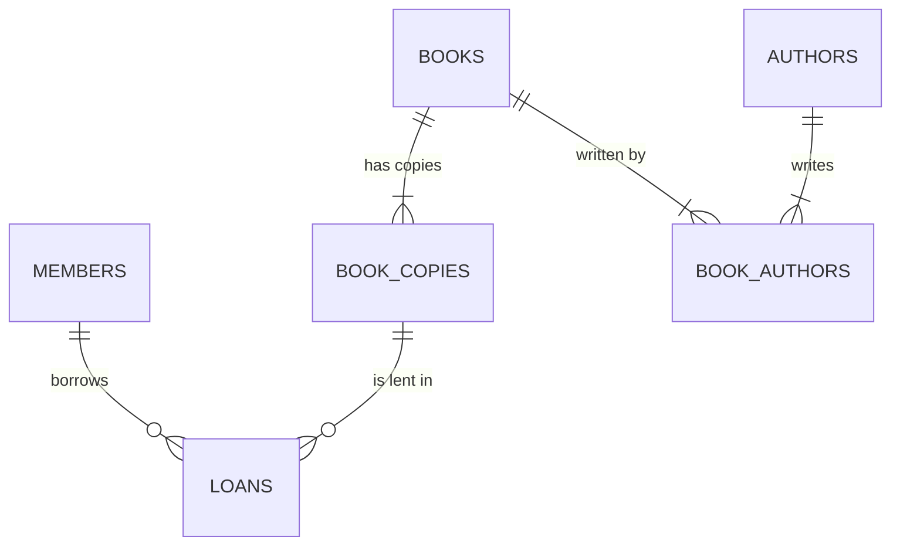

# Database Normalization: The Complete Beginner-to-Advanced Guide

> **Goal of this guide:** after reading it (and doing the exercises), you should be able to look at any messy table, find its problems, and redesign it cleanly, and explain *why* each step is done.
>
> **How it is organised:** every idea is explained in plain words first, then shown with a small example, a table and (where useful) a figure. Do not skip Part 1 and Part 2; everything later depends on them.

---

## Table of Contents

| Part | Title |
|---|---|
| 1 | What is normalization and why do we need it? |
| 2 | Building blocks: keys, attributes and functional dependencies |
| 3 | The three anomalies (the pain normalization cures) |
| 4 | Step 0: Unnormalized form (UNF / 0NF) |
| 5 | First Normal Form (1NF) |
| 6 | Second Normal Form (2NF) |
| 7 | Third Normal Form (3NF) |
| 8 | Boyce–Codd Normal Form (BCNF) |
| 9 | Fourth Normal Form (4NF) and multivalued dependencies |
| 10 | Fifth Normal Form (5NF) and join dependencies |
| 11 | Beyond 5NF (just a map) |
| 12 | Lossless joins and dependency preservation |
| 13 | A full worked example: from spreadsheet to clean database (with SQL) |
| 14 | A repeatable recipe: how to normalize anything |
| 15 | Denormalization: when to break the rules on purpose |
| 16 | Common mistakes |
| 17 | Cheat sheet |
| 18 | Practice exercises (with full solutions) |
| 19 | Quick quiz |
| 20 | Glossary and study plan |

---

# Part 1: What is normalization and why do we need it?

## 1.1 The idea in one sentence

**Normalization is the process of organising data into well-structured tables so that every fact is stored in exactly one place.**

## 1.2 A real-life analogy

Imagine your phone's contact list. Suppose that, instead of one contact card per person, every *message* you ever received stored the sender's full name, phone number and address inside it.

```
  Message 1: "Hi!"      from Rahim, 01711..., Dhaka
  Message 2: "Call me"  from Rahim, 01711..., Dhaka
  Message 3: "Thanks"   from Rahim, 01711..., Dhaka
```

If Rahim changes his number you must edit **every message**. Miss one and your phone now "knows" two different numbers for Rahim. The sensible design is:

```
  CONTACTS                              MESSAGES
  +----+--------+-------------+         +----+------------+-----------+
  | id | name   | phone       |  <----  | id | contact_id | text      |
  +----+--------+-------------+         +----+------------+-----------+
  | 7  | Rahim  | 01711...    |         | 1  | 7          | Hi!       |
  +----+--------+-------------+         | 2  | 7          | Call me   |
                                         | 3  | 7          | Thanks    |
   Rahim's phone is stored ONCE          +----+------------+-----------+
```

That is normalization in a nutshell.

## 1.3 What normalization gives you

| Benefit | Meaning |
|---|---|
| Less redundancy | The same fact is not copied many times |
| Consistency | There is one "true" copy, so no conflicting versions |
| Safe changes | One edit in one place |
| Smaller storage | Less repeated text |
| Clearer design | Each table describes one thing |

## 1.4 What it costs

| Cost | Meaning |
|---|---|
| More tables | One flat table becomes several |
| More JOINs | Reading data back together needs joins |
| Slightly slower reads (sometimes) | Joins have a cost, though usually small with good indexes |

We will return to this trade-off in Part 15.

## 1.5 The normal forms at a glance

Normal forms are **levels of tidiness**. Each level includes the one before it.

```
+-----------------------------------------------------------------+
| 1NF   atomic values, no repeating groups, has a key             |
|  +-----------------------------------------------------------+  |
|  | 2NF   + no PARTIAL dependency on a key                    |  |
|  |  +-----------------------------------------------------+  |  |
|  |  | 3NF   + no TRANSITIVE dependency                    |  |  |
|  |  |  +-----------------------------------------------+  |  |  |
|  |  |  | BCNF   every determinant is a superkey        |  |  |  |
|  |  |  |  +-----------------------------------------+  |  |  |  |
|  |  |  |  | 4NF   + no unwanted multivalued dep.    |  |  |  |  |
|  |  |  |  |  +-----------------------------------+  |  |  |  |  |
|  |  |  |  |  | 5NF   + no unwanted join dep.     |  |  |  |  |  |
|  |  |  |  |  +-----------------------------------+  |  |  |  |  |
|  |  |  |  +-----------------------------------------+  |  |  |  |
|  |  |  +-----------------------------------------------+  |  |  |
|  |  +-----------------------------------------------------+  |  |
|  +-----------------------------------------------------------+  |
+-----------------------------------------------------------------+
   A table in 5NF is also in 4NF, BCNF, 3NF, 2NF and 1NF.
```

| Normal form | One-line rule | What it removes |
|---|---|---|
| **1NF** | One value per cell, no repeating groups, a key exists | Lists in cells, repeated columns |
| **2NF** | 1NF + every non-key column depends on the *whole* key | Partial dependencies |
| **3NF** | 2NF + non-key columns depend on *nothing but* the key (or are part of a key) | Transitive dependencies |
| **BCNF** | For every dependency `X → Y`, X is a superkey | Leftover anomalies from overlapping keys |
| **4NF** | BCNF + no non-trivial multivalued dependencies | Independent lists crammed in one table |
| **5NF** | 4NF + every join dependency is implied by candidate keys | Complex cyclic redundancy |

> **In practice:** most real databases aim for **3NF or BCNF**. 4NF and 5NF matter in special situations.

---

# Part 2: Building blocks: keys, attributes and functional dependencies

You cannot understand 2NF, 3NF and BCNF without these ideas. Read this part slowly.

## 2.1 Basic vocabulary

| Term | Plain meaning | Example |
|---|---|---|
| **Table (relation)** | A set of rows with the same columns | `students` |
| **Row (tuple, record)** | One entry | one student |
| **Column (attribute, field)** | One property | `email` |
| **Domain** | The allowed values of a column | `age` is a whole number 0–120 |
| **Atomic value** | A single indivisible value (for our purpose) | `"Dhaka"` rather than `"Dhaka, Sylhet"` |

## 2.2 Keys: the full family

A **key** is a column (or set of columns) used to identify rows.

Example table `students`:

| student_id | email | national_id | name | phone |
|---|---|---|---|---|
| 1 | a@x.com | 1990001 | Ayesha | 01711000001 |
| 2 | b@x.com | 1990002 | Babul | 01711000002 |
| 3 | c@x.com | 1990003 | Ayesha | 01711000003 |

(Names can repeat; the others cannot.)

| Key type | Definition | In the example |
|---|---|---|
| **Superkey** | Any set of columns that uniquely identifies a row (may contain extra columns) | `{student_id}`, `{student_id, name}`, `{email}`, `{email, phone}` ... |
| **Candidate key** | A *minimal* superkey: remove any column and it stops being unique | `{student_id}`, `{email}`, `{national_id}` |
| **Primary key (PK)** | The one candidate key you choose as the main identifier | `student_id` |
| **Alternate key** | A candidate key you did **not** choose | `email`, `national_id` |
| **Composite key** | A key made of 2 or more columns | `(order_id, product_id)` in an order-lines table |
| **Foreign key (FK)** | A column that holds the PK value of another table, linking them | `orders.customer_id` → `customers.customer_id` |
| **Surrogate key** | An artificial key with no business meaning (e.g. auto-increment id) | `student_id` |
| **Natural key** | A key that has real-world meaning | `national_id` |

**Figure: how the key types are related**

```
   ALL SUPERKEYS
   +------------------------------------------------------+
   |  {student_id, name}   {email, phone}   {student_id,...} |
   |        +-----------------------------------------+     |
   |        |   CANDIDATE KEYS (minimal superkeys)    |     |
   |        |  {student_id}  {email}  {national_id}   |     |
   |        |        +----------------------+         |     |
   |        |        | PRIMARY KEY          |         |     |
   |        |        | {student_id}         |         |     |
   |        |        +----------------------+         |     |
   |        +-----------------------------------------+     |
   +------------------------------------------------------+
```

## 2.3 Prime and non-prime attributes

- A **prime attribute** is a column that is part of **any** candidate key.
- A **non-prime attribute** (non-key attribute) is a column that is part of **no** candidate key.

Example: in `order_items(order_id, product_id, qty)` with key `(order_id, product_id)`:
- Prime: `order_id`, `product_id`
- Non-prime: `qty`

This distinction is exactly what separates 3NF from BCNF later.

## 2.4 Functional dependency (FD): the heart of normalization

> **`A → B`** (read "A determines B") means: **if you know the value of A, you can know the value of B for certain.**
> Two rows with the same A must have the same B.

Examples:

| FD | Reads as | True? |
|---|---|---|
| `student_id → name` | Knowing the student id gives the name | Yes |
| `name → student_id` | Knowing the name gives the id | **No** (two Ayeshas) |
| `product_id → product_name, price` | A product id gives its name and price | Yes |
| `(order_id, product_id) → qty` | An order and product give the quantity | Yes |
| `zip_code → city` | A postcode gives the city | Usually yes (depends on the country's rules) |

**Visual:**

```
   student_id ───────────► name          (arrow = "determines")
   student_id ───────────► email
   (order_id, product_id) ──► qty
```

### Important: FDs come from the real world, not from sample data

A tiny sample may *look* like it has a dependency by accident. Always ask the business:

| Sample data | Accident? |
|---|---|
| Only two employees exist and they have different salaries, so `salary → emp_id` "holds" | Yes. A third employee may share a salary. |

**Rule:** FDs are *rules of the business*. Ask "Can two different X ever have the same Y?" and "Can the same X ever have two different Y?"

### Types of dependency

| Type | Definition | Example |
|---|---|---|
| **Trivial** | `X → Y` where Y is already inside X | `(order_id, product_id) → order_id` |
| **Non-trivial** | Y is not inside X | `order_id → order_date` |
| **Full** | Y depends on the *whole* composite key, not any smaller part | `(order_id, product_id) → qty` |
| **Partial** | Y depends on only *part* of a composite key | `product_id → product_name` inside key `(order_id, product_id)` |
| **Transitive** | `A → B` and `B → C` (B is not a key), so `A → C` is indirect | `order_id → customer_id → customer_name` |

**Figure: partial vs transitive**

```
 PARTIAL                                   TRANSITIVE
 key = (order_id, product_id)              key = order_id

 order_id ──┐                              order_id ──► customer_id ──► customer_name
            ├──► qty        (full)                      (non-key)         (non-key)
 product_id ┘
 product_id ──► product_name   <-- only HALF the key    customer_name hangs off a non-key
```

## 2.5 Determinant

The left side of an FD is called the **determinant**. In `customer_id → customer_name`, the determinant is `customer_id`. BCNF is all about determinants.

## 2.6 Armstrong's axioms (the rules for reasoning with FDs)

You can derive new FDs from known ones.

| Rule | Statement | Example |
|---|---|---|
| **Reflexivity** | If Y ⊆ X then `X → Y` | `(A,B) → A` |
| **Augmentation** | If `X → Y` then `XZ → YZ` | `A → B` gives `AC → BC` |
| **Transitivity** | If `X → Y` and `Y → Z` then `X → Z` | `A → B`, `B → C` gives `A → C` |
| *Union (derived)* | `X → Y` and `X → Z` give `X → YZ` | |
| *Decomposition (derived)* | `X → YZ` gives `X → Y` and `X → Z` | |
| *Pseudo-transitivity (derived)* | `X → Y` and `YW → Z` give `XW → Z` | |

## 2.7 Attribute closure: the tool for finding keys

The **closure** of a set of attributes X, written **X⁺**, is *everything X can determine*.

**Algorithm:**
1. Start with `result = X`.
2. Look at every FD `P → Q`. If P is inside `result`, add Q to `result`.
3. Repeat until nothing new is added.

**Key fact:** X is a **superkey** if X⁺ contains *all* attributes. It is a **candidate key** if, in addition, no smaller subset works.

### Worked example

Relation `R(A, B, C, D, E)` with FDs:

```
A → B
B → C
C D → E
```

Find the candidate key(s).

**Step 1: which attributes never appear on a right-hand side?** The right sides contain B, C, E. So **A and D never appear on the right**, meaning nothing else can determine them. Therefore **A and D must be inside every candidate key**.

**Step 2: compute (AD)⁺**

| Round | Result so far | FD used | Added |
|---|---|---|---|
| start | {A, D} | | |
| 1 | {A, D, B} | A → B | B |
| 2 | {A, D, B, C} | B → C | C |
| 3 | {A, D, B, C, E} | CD → E | E |

(AD)⁺ = {A, B, C, D, E} = **all attributes**, so AD is a superkey. It is minimal because A⁺ = {A, B, C} and D⁺ = {D} are both incomplete.

**Result: the only candidate key is `AD`.**

---

# Part 3: The three anomalies (the pain normalization cures)

An **anomaly** is a problem caused by poor design. Take this "everything in one table" design of a course registration system:

| student_id | student_name | course_id | course_name | instructor | grade |
|---|---|---|---|---|---|
| S1 | Ayesha | C1 | Databases | Dr. Rahman | A |
| S1 | Ayesha | C2 | Networks | Dr. Karim | B |
| S2 | Babul | C1 | Databases | Dr. Rahman | B |
| S3 | Chitra | C1 | Databases | Dr. Rahman | A |

Key: `(student_id, course_id)`.

## 3.1 Update anomaly

**Dr. Rahman is replaced by Dr. Sultana for Databases.** You must edit **3 rows**. If you edit only 2, the database now says two different instructors teach C1.

```
  Row 1: C1 -> Dr. Sultana  (updated)
  Row 3: C1 -> Dr. Rahman   (forgotten!)   <-- contradiction
  Row 4: C1 -> Dr. Sultana  (updated)
```

## 3.2 Insertion anomaly

**A new course "C3 Security" is approved but no student has enrolled.** You cannot store it, because `student_id` is part of the key and cannot be empty. The course fact has nowhere to live.

## 3.3 Deletion anomaly

**Student S2 (Babul) drops out and his only row is deleted.** Nothing else is lost here, but now imagine C2 Networks has only one student (Ayesha). If Ayesha's C2 row is deleted, **you lose the fact that Networks exists and that Dr. Karim teaches it.**

## 3.4 Summary

| Anomaly | You want to... | Problem |
|---|---|---|
| Update | change one fact | must change many rows; risk of inconsistency |
| Insert | add one fact | cannot, unless an unrelated fact exists |
| Delete | remove one fact | accidentally destroys another fact |

**The cause of all three is the same: several different facts are mixed in one table.** Normalization separates the facts.

---

# Part 4: Step 0: Unnormalized form (UNF / 0NF)

A table that is **not even in 1NF**. It usually looks like a spreadsheet or a paper form, with lists inside cells and repeated groups.

## 4.1 Our running example: an online shop's order sheet

We will follow this example from UNF all the way to 3NF.

| OrderID | OrderDate | CustomerID | CustomerName | City | Items (product, name, price, qty) |
|---|---|---|---|---|---|
| 1001 | 2026-01-05 | C01 | Rahim | Dhaka | {P10, Pen, 10.00, 5} {P20, Notebook, 60.00, 2} |
| 1002 | 2026-01-06 | C02 | Karima | Chattogram | {P10, Pen, 10.00, 3} |
| 1003 | 2026-01-07 | C01 | Rahim | Dhaka | {P30, Bag, 450.00, 1} {P20, Notebook, 60.00, 4} |

**What is wrong?** The last column holds a **list of items in one cell** (a *repeating group*). You cannot easily answer "how many Notebooks were sold?"

---

# Part 5: First Normal Form (1NF)

## 5.1 The rules

A table is in **1NF** if:

1. Every cell contains **one atomic value** (no lists, no sets).
2. There are **no repeating groups** (no columns like `phone1, phone2, phone3`).
3. Each row is **unique**, so the table has a **primary key**.
4. Values in a column are all of the **same kind**.

## 5.2 Three typical violations and their fixes

### Violation A: a list in one cell

| student_id | name | phones |
|---|---|---|
| 1 | Ayesha | 01711000001, 01811000002 |

**Fix: one row per value**, or better, a separate table when the number is unlimited.

| student_id | phone |
|---|---|
| 1 | 01711000001 |
| 1 | 01811000002 |

### Violation B: repeated columns

| student_id | name | phone1 | phone2 | phone3 |
|---|---|---|---|---|
| 1 | Ayesha | 01711000001 | 01811000002 | NULL |

Problems: how many columns is enough? Searching "who has number X?" needs `phone1 = X OR phone2 = X OR phone3 = X`.

**Fix: a child table.**

```
 students                          student_phones
 +------------+--------+           +------------+-------------+
 | student_id | name   |  1 ──< *  | student_id | phone       |
 +------------+--------+           +------------+-------------+
 | 1          | Ayesha |           | 1          | 01711000001 |
 +------------+--------+           | 1          | 01811000002 |
                                    +------------+-------------+
```

### Violation C: a non-atomic value that you actually need in parts

| name | address |
|---|---|
| Rahim | House 5, Road 3, Dhanmondi, Dhaka 1205 |

If you need to search or group by city, split it: `house`, `road`, `area`, `city`, `postcode`. (Use judgement: if you never need the parts, a single text column can be acceptable.)

> **Modern note:** a JSON or array column in MySQL/PostgreSQL stores a list in one cell, which breaks the *spirit* of 1NF. It can be fine for rarely queried, flexible data, but not for facts you want to filter, join or constrain.

## 5.3 Applying 1NF to our order sheet

**Steps:**
1. One row per order line.
2. Choose the key. `OrderID` alone repeats (order 1001 has 2 rows), so use the **composite key `(OrderID, ProductID)`**.

**1NF table (PK = OrderID + ProductID)**

| OrderID | ProductID | OrderDate | CustomerID | CustomerName | City | ProductName | Price | Qty |
|---|---|---|---|---|---|---|---|---|
| 1001 | P10 | 2026-01-05 | C01 | Rahim | Dhaka | Pen | 10.00 | 5 |
| 1001 | P20 | 2026-01-05 | C01 | Rahim | Dhaka | Notebook | 60.00 | 2 |
| 1002 | P10 | 2026-01-06 | C02 | Karima | Chattogram | Pen | 10.00 | 3 |
| 1003 | P30 | 2026-01-07 | C01 | Rahim | Dhaka | Bag | 450.00 | 1 |
| 1003 | P20 | 2026-01-07 | C01 | Rahim | Dhaka | Notebook | 60.00 | 4 |

It is in 1NF, but look at the repetition: Rahim's name and city appear in 4 rows; Pen's name and price appear twice. The anomalies are still here.

## 5.4 Anomalies in this 1NF table

| Anomaly | Example in this table |
|---|---|
| Update | Rahim moves to Sylhet: edit 4 rows |
| Insert | New product P40 "Marker" that nobody ordered yet: cannot insert (OrderID is part of the key) |
| Delete | Delete order 1002: Karima's customer details are lost (her only order) |

---

# Part 6: Second Normal Form (2NF)

## 6.1 The rule

A table is in **2NF** if:

1. It is in **1NF**, and
2. **No non-prime attribute depends on only part of a candidate key** (no partial dependencies).

### When does 2NF matter?

Only when the key is **composite**. If the primary key is a single column and the table is in 1NF, it is **automatically in 2NF** (a single column has no "part").

## 6.2 How to test for 2NF (a method you can always use)

For each non-key column ask: **"To know this value, is part of the key enough?"**
If yes, it is a partial dependency, so move it out.

## 6.3 Applying 2NF to the order sheet

Key = `(OrderID, ProductID)`. Test each column:

| Column | Determined by | Verdict |
|---|---|---|
| OrderDate | OrderID alone | **Partial** |
| CustomerID | OrderID alone | **Partial** |
| CustomerName | OrderID alone (via CustomerID) | **Partial** |
| City | OrderID alone (via CustomerID) | **Partial** |
| ProductName | ProductID alone | **Partial** |
| Price | ProductID alone | **Partial** |
| Qty | (OrderID, ProductID) together | Full |

**Figure: the dependencies before 2NF**

```
  OrderID ─────────────► OrderDate, CustomerID, CustomerName, City
                         (depends on HALF the key)

  ProductID ───────────► ProductName, Price
                         (depends on the OTHER HALF)

  (OrderID, ProductID) ─► Qty
                         (depends on the WHOLE key)
```

**Solution:** one table for each "determinant group".

```
  1NF table
     |
     +--> ORDERS      (OrderID PK)  : OrderDate, CustomerID, CustomerName, City
     +--> PRODUCTS    (ProductID PK): ProductName, Price
     +--> ORDER_ITEMS (OrderID+ProductID PK): Qty
```

### 2NF result

**ORDERS** (PK = OrderID)

| OrderID | OrderDate | CustomerID | CustomerName | City |
|---|---|---|---|---|
| 1001 | 2026-01-05 | C01 | Rahim | Dhaka |
| 1002 | 2026-01-06 | C02 | Karima | Chattogram |
| 1003 | 2026-01-07 | C01 | Rahim | Dhaka |

**PRODUCTS** (PK = ProductID)

| ProductID | ProductName | Price |
|---|---|---|
| P10 | Pen | 10.00 |
| P20 | Notebook | 60.00 |
| P30 | Bag | 450.00 |

**ORDER_ITEMS** (PK = OrderID + ProductID; both are also FKs)

| OrderID | ProductID | Qty |
|---|---|---|
| 1001 | P10 | 5 |
| 1001 | P20 | 2 |
| 1002 | P10 | 3 |
| 1003 | P30 | 1 |
| 1003 | P20 | 4 |

**Better:** Pen's price is stored once; order dates are stored once per order.
**Still wrong:** in `ORDERS`, Rahim's name and city still repeat (orders 1001 and 1003). That is a **transitive dependency**, which 3NF removes.

---

# Part 7: Third Normal Form (3NF)

## 7.1 The rule

A table is in **3NF** if:

1. It is in **2NF**, and
2. **No non-prime attribute depends on another non-prime attribute** (no transitive dependencies).

**Formal version (useful for exams):** for every non-trivial FD `X → A`, **either** X is a superkey, **or** A is a prime attribute.

## 7.2 Memory trick

> Every non-key column must give a fact about **the key, the whole key, and nothing but the key.**
> *(so help me Codd)*

| Phrase | Normal form it enforces |
|---|---|
| "the key" | 1NF (there is a key) |
| "the whole key" | 2NF (no partial dependency) |
| "nothing but the key" | 3NF (no transitive dependency) |

## 7.3 How to test for 3NF

For each non-key column ask: **"Is it really described by the key, or by some other non-key column?"**

## 7.4 Applying 3NF to the order sheet

In `ORDERS`:

```
  OrderID ──► CustomerID ──► CustomerName, City
   (key)       (non-key)        (non-key)

  CustomerName and City describe the CUSTOMER, not the ORDER.
```

**Fix:** move customer facts to a `CUSTOMERS` table; keep only `CustomerID` (a foreign key) in `ORDERS`.

### 3NF result (final design)

**CUSTOMERS** (PK = CustomerID)

| CustomerID | CustomerName | City |
|---|---|---|
| C01 | Rahim | Dhaka |
| C02 | Karima | Chattogram |

**ORDERS** (PK = OrderID, FK CustomerID → CUSTOMERS)

| OrderID | OrderDate | CustomerID |
|---|---|---|
| 1001 | 2026-01-05 | C01 |
| 1002 | 2026-01-06 | C02 |
| 1003 | 2026-01-07 | C01 |

**PRODUCTS** (PK = ProductID)

| ProductID | ProductName | Price |
|---|---|---|
| P10 | Pen | 10.00 |
| P20 | Notebook | 60.00 |
| P30 | Bag | 450.00 |

**ORDER_ITEMS** (PK = OrderID + ProductID; FKs to ORDERS and PRODUCTS)

| OrderID | ProductID | Qty |
|---|---|---|
| 1001 | P10 | 5 |
| 1001 | P20 | 2 |
| 1002 | P10 | 3 |
| 1003 | P30 | 1 |
| 1003 | P20 | 4 |

**Figure: the final ERD**



## 7.5 Check: are the anomalies gone?

| Situation | Before (1NF table) | After (3NF) |
|---|---|---|
| Rahim moves to Sylhet | edit 4 rows | edit **1 row** in `customers` |
| New product "Marker", never ordered | impossible | insert 1 row in `products` |
| Delete order 1002 | Karima's data lost | Karima stays in `customers` |
| Pen's price changes | edit every Pen row | edit 1 row in `products` |

## 7.6 A real-world refinement: price at the time of sale

In the design above, `Price` lives in `PRODUCTS`. If the price changes next month, **old orders would silently show the new price**, which is wrong for invoices. In real shops you store the **price actually charged** on the order line:

`ORDER_ITEMS(order_id, product_id, qty, sale_price)`

Is this a normalization violation? **No.** `sale_price` depends on the whole key `(order_id, product_id)`, because it is the price agreed for *that line*. It is a different fact from the product's current list price. (We use this version in the SQL in Part 13.)

## 7.7 Derived data: don't store what you can calculate

`line_total = qty × sale_price` and `order_total = SUM(line_total)` can be computed any time. Storing them risks getting out of sync with the real values. (Exceptions are covered in Part 15.)

---

# Part 8: Boyce–Codd Normal Form (BCNF)

## 8.1 The rule

A table is in **BCNF** if, for **every** non-trivial FD `X → Y`, **X is a superkey.**

In words: *every determinant must be a candidate key (or contain one).*

## 8.2 Why does BCNF exist if we already have 3NF?

3NF has a loophole: it allows `X → A` when X is not a superkey **if A is a prime attribute**. This loophole matters only when a table has **several overlapping candidate keys**. BCNF closes the loophole.

> **Relationship:** every BCNF table is in 3NF, but not every 3NF table is in BCNF.

## 8.3 Example: 3NF but not BCNF

**Business rules**
- A student can take a course, and is taught by exactly **one teacher** for that course.
- Each teacher teaches **only one course** (but a course can have several teachers).

**Table `enrollments(student, course, teacher)`**

| student | course | teacher |
|---|---|---|
| Alice | Databases | Dr. Rahman |
| Bob | Databases | Dr. Rahman |
| Alice | Networks | Dr. Karim |
| Carol | Databases | Dr. Sultana |

**Functional dependencies**
1. `(student, course) → teacher` (a student has one teacher per course)
2. `teacher → course` (a teacher teaches only one course)

**Candidate keys**
- `(student, course)`: determines teacher, so determines everything
- `(student, teacher)`: teacher gives course, so determines everything

Both keys are valid. So **student, course and teacher are all prime attributes.**

**Is it 3NF?** Check FD 2, `teacher → course`: teacher is not a superkey, **but `course` is a prime attribute** (it is inside the key `(student, course)`). The 3NF loophole applies, so **yes, it is in 3NF.**

**Is it BCNF?** FD 2 has determinant `teacher`, which is **not** a superkey. **No, it violates BCNF.**

**The anomaly it still has:** if Dr. Sultana is the only teacher recorded for a course and Carol drops it, the fact "Dr. Sultana teaches Databases" disappears. Also, the course name for Dr. Rahman is repeated in every row.

**Decomposing to BCNF:** split on the violating FD `teacher → course`.

**teacher_course** (PK = teacher)

| teacher | course |
|---|---|
| Dr. Rahman | Databases |
| Dr. Karim | Networks |
| Dr. Sultana | Databases |

**student_teacher** (PK = student + teacher)

| student | teacher |
|---|---|
| Alice | Dr. Rahman |
| Bob | Dr. Rahman |
| Alice | Dr. Karim |
| Carol | Dr. Sultana |

Joining the two on `teacher` returns exactly the original rows. This is a **lossless** decomposition (Part 12).

### The honest trade-off

After this split, the rule `(student, course) → teacher` (a student must not have two different teachers for the same course) can **no longer be enforced by a simple key or FK** in one table, because `student` and `course` now live in different tables. BCNF decomposition is always lossless but **may not preserve all dependencies**. This is exactly why many practical designs stop at 3NF in such cases. See Part 12.

## 8.4 BCNF decomposition algorithm

```
Repeat:
   1. Find an FD  X → Y  in table R where X is NOT a superkey.
   2. Split R into:
        R1 = X ∪ Y            (the determinant and what it determines)
        R2 = R − (Y − X)      (everything else, keeping X as the link)
Until every table is in BCNF.
```

---

# Part 9: Fourth Normal Form (4NF) and multivalued dependencies

## 9.1 Multivalued dependency (MVD)

An MVD `X ↠ Y` ("X multi-determines Y") means: **for each X, there is a set of Y values, and that set is independent of every other column.**

Everyday example: a person has a **set of skills** and a **set of spoken languages**. Skills and languages are unrelated to each other.

## 9.2 The problem: two independent lists in one table

Employee 1 has skills {Java, SQL} and speaks {English, Bangla}.

**Bad design `employee_info(emp_id, skill, language)`**, which must store *every combination*:

| emp_id | skill | language |
|---|---|---|
| 1 | Java | English |
| 1 | Java | Bangla |
| 1 | SQL | English |
| 1 | SQL | Bangla |

2 skills × 2 languages = **4 rows** for 4 facts. Add a third skill and you must add 2 more rows. Add a language and you must add one row per skill. If you forget one combination, the data suggests Java is tied to English only.

This table has no non-trivial FDs (its only key is all three columns, so it is in BCNF), yet it is clearly badly designed. The culprit is the **MVDs**: `emp_id ↠ skill` and `emp_id ↠ language`.

## 9.3 The 4NF rule

A table is in **4NF** if it is in BCNF and, for every non-trivial MVD `X ↠ Y`, **X is a superkey.**

## 9.4 Fix: one table per independent list

**employee_skills** (PK = emp_id + skill)

| emp_id | skill |
|---|---|
| 1 | Java |
| 1 | SQL |

**employee_languages** (PK = emp_id + language)

| emp_id | language |
|---|---|
| 1 | English |
| 1 | Bangla |

4 facts are now stored in 4 cells' worth of rows, with no forced combinations, and adding a skill is one row.

```
 BEFORE (4NF violated)                 AFTER (4NF)
 +--------+-------+----------+         +--------+-------+     +--------+----------+
 | emp_id | skill | language |         | emp_id | skill |     | emp_id | language |
 +--------+-------+----------+  --->   +--------+-------+     +--------+----------+
 | 1      | Java  | English  |         | 1      | Java  |     | 1      | English  |
 | 1      | Java  | Bangla   |         | 1      | SQL   |     | 1      | Bangla   |
 | 1      | SQL   | English  |         +--------+-------+     +--------+----------+
 | 1      | SQL   | Bangla   |
 +--------+-------+----------+
```

> **Caution:** if the skill and the language **are** related (e.g. "Java taught in English"), the two columns are *not* independent, so there is no MVD and the single table is correct.

---

# Part 10: Fifth Normal Form (5NF) and join dependencies

5NF (also called **Project-Join Normal Form, PJNF**) deals with a rare situation: a table that can only be rebuilt by joining **three or more** smaller tables, never just two.

## 10.1 Join dependency

A table has a **join dependency** if it equals the natural join of several of its own projections (sub-tables). 5NF requires that every such join dependency is already implied by the candidate keys.

## 10.2 Example: suppliers, parts, projects

**Business rule (cyclic):** a supplier supplies a part to a project **if and only if** the supplier supplies that part, the project uses that part, **and** the supplier works for that project.

**Table `SPJ(supplier, part, project)`**

| supplier | part | project |
|---|---|---|
| S1 | P1 | J1 |
| S1 | P1 | J2 |
| S1 | P2 | J1 |
| S2 | P1 | J1 |

Key = all three columns, so there are no FDs and no MVDs, yet there is redundancy: for instance, the facts "S1 supplies P1" and "S1 works on J1" each appear on several rows.

**Decompose into three tables:**

| SP: supplier, part | PJ: part, project | SJ: supplier, project |
|---|---|---|
| S1, P1 | P1, J1 | S1, J1 |
| S1, P2 | P1, J2 | S1, J2 |
| S2, P1 | P2, J1 | S2, J1 |

**Check by joining the three:** for each pair in SP, find projects in PJ, and keep only combinations present in SJ:

| SP pair | Projects from PJ | Kept (also in SJ) |
|---|---|---|
| (S1, P1) | J1, J2 | (S1,P1,J1) and (S1,P1,J2) |
| (S1, P2) | J1 | (S1,P2,J1) |
| (S2, P1) | J1, J2 | (S2,P1,J1); (S2,P1,J2) rejected because (S2,J2) is not in SJ |

The result is **exactly the original 4 rows**. The table was safely decomposable into three tables, but **not** into any two of them.

```
        SPJ  (supplier, part, project)
         |
   +-----+------+-----------+
   v            v           v
  SP           PJ          SJ        ──►  JOIN all three = SPJ
(supplier,    (part,      (supplier,
  part)       project)     project)
```

> **When to apply 5NF:** only when the cyclic business rule really holds. If it does not hold (a supplier may supply a part to a project without the other two facts being true), then SPJ is the correct, already-normalized design and must **not** be split.
> 5NF cases are rare. Knowing 1NF to BCNF thoroughly covers nearly all real work.

---

# Part 11: Beyond 5NF (just a map)

| Normal form | One-line idea |
|---|---|
| **EKNF** (Elementary Key NF) | Between 3NF and BCNF; a refinement of the key-based rules |
| **6NF** | Every table has the key plus **at most one** other attribute; used for temporal (time-varying) data |
| **DKNF** (Domain-Key NF) | Every constraint follows from domain and key constraints; an ideal, rarely reachable in practice |

You do not need these for everyday design. They are good to *recognise* in a course or interview.

---

# Part 12: Lossless joins and dependency preservation

Normalization splits tables. Two properties tell you whether a split is **good**.

## 12.1 Lossless-join decomposition (a must-have)

A decomposition is **lossless** if joining the pieces back gives **exactly the original table**: no missing rows and no extra (spurious) rows.

**Test for splitting R into R1 and R2:**
the common attributes `R1 ∩ R2` must be a **key of R1 or a key of R2**. (Formally, `R1 ∩ R2 → R1` or `R1 ∩ R2 → R2`.)

### Lossy example (what NOT to do)

`works(emp, project, location)`

| emp | project | location |
|---|---|---|
| Ann | P1 | Dhaka |
| Bob | P2 | Dhaka |

**Bad split on `location`:**

| R1: emp, location | R2: project, location |
|---|---|
| Ann, Dhaka | P1, Dhaka |
| Bob, Dhaka | P2, Dhaka |

**Join on location gives 4 rows:**

| emp | project | location | Genuine? |
|---|---|---|---|
| Ann | P1 | Dhaka | Yes |
| Ann | P2 | Dhaka | **Spurious!** |
| Bob | P1 | Dhaka | **Spurious!** |
| Bob | P2 | Dhaka | Yes |

`location` is not a key of either piece, so information was lost (we can no longer tell who works on what).

### Lossless version

Split on `emp` (assuming each employee has one location, `emp → location`):

| R1: emp, location (key: emp) | R2: emp, project |
|---|---|
| Ann, Dhaka | Ann, P1 |
| Bob, Dhaka | Bob, P2 |

The common attribute `emp` is a key of R1, so the join returns exactly the 2 original rows.

## 12.2 Dependency preservation (nice-to-have)

A decomposition **preserves dependencies** if every original FD can still be checked **inside a single table** (without joining).

| Normal form target | Lossless guaranteed? | Dependency-preserving guaranteed? |
|---|---|---|
| **3NF** (via synthesis algorithm) | Yes | **Yes** |
| **BCNF** (via decomposition) | Yes | **Not always** (see the teacher/course example in Part 8) |

**Practical advice:**
- Aim for BCNF.
- If BCNF would lose an important rule that you cannot enforce otherwise, accept 3NF and keep the rule (or enforce it with a trigger or constraint).

---

# Part 13: A full worked example: from spreadsheet to clean database (with SQL)

We take the online-shop example to a working MySQL 8.0 database and prove that normalized data can be reassembled.

## 13.1 Create the tables

```sql
CREATE TABLE customers (
  customer_id   VARCHAR(10) PRIMARY KEY,
  customer_name VARCHAR(80) NOT NULL,
  city          VARCHAR(50) NOT NULL
);

CREATE TABLE products (
  product_id   VARCHAR(10) PRIMARY KEY,
  product_name VARCHAR(80) NOT NULL,
  price        DECIMAL(10,2) NOT NULL CHECK (price > 0)   -- current list price
);

CREATE TABLE orders (
  order_id    INT PRIMARY KEY,
  order_date  DATE NOT NULL,
  customer_id VARCHAR(10) NOT NULL,
  FOREIGN KEY (customer_id) REFERENCES customers(customer_id)
);

CREATE TABLE order_items (
  order_id   INT NOT NULL,
  product_id VARCHAR(10) NOT NULL,
  qty        INT NOT NULL CHECK (qty > 0),
  sale_price DECIMAL(10,2) NOT NULL CHECK (sale_price > 0), -- price charged on this line
  PRIMARY KEY (order_id, product_id),                        -- composite key
  FOREIGN KEY (order_id)   REFERENCES orders(order_id),
  FOREIGN KEY (product_id) REFERENCES products(product_id)
);
```

## 13.2 Insert the data

```sql
INSERT INTO customers VALUES ('C01','Rahim','Dhaka'), ('C02','Karima','Chattogram');
INSERT INTO products  VALUES ('P10','Pen',10.00), ('P20','Notebook',60.00), ('P30','Bag',450.00);
INSERT INTO orders    VALUES (1001,'2026-01-05','C01'), (1002,'2026-01-06','C02'), (1003,'2026-01-07','C01');
INSERT INTO order_items VALUES
  (1001,'P10',5,10.00), (1001,'P20',2,60.00),
  (1002,'P10',3,10.00),
  (1003,'P30',1,450.00), (1003,'P20',4,60.00);
```

## 13.3 Rebuild the original flat view with JOINs

```sql
SELECT o.order_id, o.order_date, c.customer_id, c.customer_name, c.city,
       p.product_id, p.product_name, oi.sale_price, oi.qty
FROM order_items oi
JOIN orders    o ON o.order_id    = oi.order_id
JOIN customers c ON c.customer_id = o.customer_id
JOIN products  p ON p.product_id  = oi.product_id
ORDER BY o.order_id, p.product_id;
```

This returns the same 5 rows as the 1NF table in Part 5. **Nothing was lost.**

## 13.4 Derived totals (calculated, not stored)

```sql
SELECT order_id, SUM(qty * sale_price) AS order_total
FROM order_items
GROUP BY order_id;
```

| order_id | order_total |
|---|---|
| 1001 | 170.00 |
| 1002 | 30.00 |
| 1003 | 690.00 |

(1001: 5×10 + 2×60 = 170. 1002: 3×10 = 30. 1003: 1×450 + 4×60 = 690.)

## 13.5 Anomalies are now easy

```sql
-- Update anomaly gone: Rahim moves, ONE row changes
UPDATE customers SET city = 'Sylhet' WHERE customer_id = 'C01';

-- Insert anomaly gone: add a product nobody ordered yet
INSERT INTO products VALUES ('P40','Marker',25.00);
```

**Deleting an order** no longer deletes the customer, because they are in different tables. (The foreign keys also stop you from deleting a customer who still has orders.)

---

# Part 14: A repeatable recipe: how to normalize anything



## 14.1 The recipe as a checklist

| Step | Action | Tip |
|---|---|---|
| 1 | List every attribute | Include columns from forms, reports and spreadsheets |
| 2 | Write the FDs | Ask: "If I know X, do I know Y for certain?" |
| 3 | Find candidate keys | Use closure; attributes never on a right-hand side must be in every key |
| 4 | Check/repair 1NF | One value per cell |
| 5 | Check/repair 2NF | Only if the key is composite |
| 6 | Check/repair 3NF | Look for "A → B → C" chains |
| 7 | Check BCNF | List every determinant; is each a superkey? |
| 8 | Check for independent lists (4NF) | Two unrelated many-valued facts in one table |
| 9 | Verify losslessness | Common attributes must be a key of one piece |
| 10 | Implement | Add keys and constraints; test with real queries |

## 14.2 Good questions to ask while finding FDs

| Question | What it reveals |
|---|---|
| "Can two different X have the same Y?" | Whether `Y → X` is false |
| "Can one X have two different Y at the same time?" | Whether `X → Y` is false |
| "What identifies one of these uniquely?" | Candidate keys |
| "If I delete this row, what other facts would vanish?" | Hidden mixed facts (deletion anomaly) |
| "Is this value a fact about the thing in this row, or about something else?" | Transitive dependencies |

---

# Part 15: Denormalization: when to break the rules on purpose

**Denormalization** means deliberately adding redundancy back to a normalized design, to make some reads faster or simpler.

## 15.1 Why, and when?

| Situation | Typical technique |
|---|---|
| Reports repeatedly join many big tables | Pre-computed summary table |
| Very read-heavy dashboards | Copy a few columns into the reading table |
| Data warehouses (analytics) | **Star schema** (a wide fact table plus flat dimension tables) |
| Need a historical snapshot | Copy the value at that time (e.g. `sale_price`, delivery address on an order) |
| Expensive aggregate | Store `order_total` and keep it updated with a trigger or in the app |

## 15.2 Trade-offs

| Normalized | Denormalized |
|---|---|
| Writes are simple and safe | Writes must keep copies in sync |
| Reads need joins | Reads are faster and simpler |
| Low storage | More storage |
| Best for **OLTP** (many small transactions) | Often used for **OLAP** (reports and analytics) |

## 15.3 The golden rule

> **Normalize first. Denormalize only when you have measured a real performance problem, and document every duplicate and how it is kept in sync.**

Note: a *snapshot* such as `sale_price` is not really denormalization. It is a different fact, as explained in 7.6.

---

# Part 16: Common mistakes

| # | Mistake | Why it is wrong | Correct approach |
|---|---|---|---|
| 1 | Thinking "more tables = more normalized" | Splitting without a reason can lose data | Split only to remove a dependency problem, and check losslessness |
| 2 | Deciding FDs from sample data | A small sample can hide or invent patterns | Ask what the business rules say |
| 3 | Checking 2NF when the key is a single column | 2NF is only about partial dependency on a composite key | Single-column key + 1NF = automatically 2NF |
| 4 | Forgetting prime attributes in the 3NF test | 3NF allows `X → A` if A is prime | Use the full 3NF definition (see Part 7) |
| 5 | Storing derived values (totals, ages) | They get out of sync | Calculate in a query or view |
| 6 | Using repeated columns (`phone1`, `phone2`) | Hard limits; awkward queries | Child table |
| 7 | Putting a lookup name in every row (`city_name` repeated) | Update anomalies | Lookup table with FK (when it really is an entity you maintain) |
| 8 | Ignoring that prices/addresses change over time | Old records silently change | Snapshot the value on the transaction row |
| 9 | Over-normalizing trivial things | A `genders` table for 'M'/'F' adds joins with little benefit | Use judgement; a CHECK or ENUM can be enough |
| 10 | Skipping the keys | Without PK/FK constraints the design isn't enforced | Declare PK, FK, UNIQUE, NOT NULL, CHECK |

---

# Part 17: Cheat sheet

## 17.1 One-page summary

| NF | Test question | Fix |
|---|---|---|
| **1NF** | "One value per cell? No repeating columns? Is there a key?" | Split lists into rows or tables; choose a key |
| **2NF** | "Does any non-key column depend on only PART of the key?" | Move it with that part to a new table |
| **3NF** | "Does any non-key column depend on another non-key column?" | Move them to their own table; keep an FK |
| **BCNF** | "Is every determinant a superkey?" | Split on the violating FD |
| **4NF** | "Are two independent lists stored together?" | One table per list |
| **5NF** | "Does the table only rebuild from 3+ pieces (cyclic rule)?" | Split into those pieces |

## 17.2 Dependency types

| Type | Pattern | Violates |
|---|---|---|
| Partial | Part of key → column | 2NF |
| Transitive | Key → A → B (A non-key) | 3NF |
| Non-key determinant | `X → Y` with X not a superkey | BCNF |
| Multivalued | `X ↠ Y` independent lists | 4NF |
| Join | Rebuildable only from 3+ projections | 5NF |

## 17.3 Formal definitions (for exams)

- **2NF:** in 1NF, and every non-prime attribute is fully functionally dependent on every candidate key.
- **3NF:** for every non-trivial FD `X → A`, X is a superkey **or** A is a prime attribute.
- **BCNF:** for every non-trivial FD `X → Y`, X is a superkey.
- **4NF:** for every non-trivial MVD `X ↠ Y`, X is a superkey.
- **5NF:** every non-trivial join dependency is implied by the candidate keys.

## 17.4 Mini-memory phrases

- 1NF: "**The key**": atomic cells and a key.
- 2NF: "**The whole key**."
- 3NF: "**Nothing but the key.**"
- BCNF: "**Every determinant is a key.**"
- 4NF: "**Don't cross-multiply independent lists.**"

---

# Part 18: Practice exercises (with full solutions)

Try each one on paper **before** reading the solution.

## Exercise 1: Which normal form is it?

For each relation, state the highest normal form it satisfies (among 1NF, 2NF, 3NF, BCNF).

**(a)** `R1(StudentID, CourseID, StudentName, Grade)`; key `(StudentID, CourseID)`; FD: `StudentID → StudentName`

**(b)** `R2(EmpID, DeptID, DeptName)`; key `EmpID`; FD: `DeptID → DeptName`

**(c)** `R3(Student, Course, Teacher)`; keys `(Student, Course)` and `(Student, Teacher)`; FD: `Teacher → Course`

**(d)** `R4(OrderID, OrderDate)`; key `OrderID`

<details>
<summary><b>Solution</b></summary>

| Relation | Analysis | Answer |
|---|---|---|
| (a) | `StudentID → StudentName` is a **partial** dependency (half of the key) | **1NF only** |
| (b) | Single-column key, so 2NF holds. `EmpID → DeptID → DeptName` is **transitive** | **2NF** (not 3NF) |
| (c) | `Teacher → Course`: Teacher is not a superkey, but Course is prime, so 3NF holds; BCNF fails | **3NF** (not BCNF) |
| (d) | Only FD is `OrderID → OrderDate` and OrderID is the key | **BCNF** |
</details>

## Exercise 2: Normalize a hospital table

`appointments(AppointmentID, PatientID, PatientName, PatientPhone, DoctorID, DoctorName, Specialty, AppointmentDate, Fee)`

Business rules: each appointment has one patient and one doctor; a doctor has a name, specialty and a standard fee.

<details>
<summary><b>Solution</b></summary>

**FDs**
- `AppointmentID → PatientID, DoctorID, AppointmentDate`
- `PatientID → PatientName, PatientPhone`
- `DoctorID → DoctorName, Specialty, Fee`

**Key:** `AppointmentID` (single column).

- 1NF: yes.
- 2NF: automatically yes (single-column key).
- 3NF: **no**. `AppointmentID → PatientID → PatientName` and `AppointmentID → DoctorID → DoctorName` are transitive.

**Result**

| Table | Columns | Keys |
|---|---|---|
| `patients` | PatientID, PatientName, PatientPhone | PK PatientID |
| `doctors` | DoctorID, DoctorName, Specialty, Fee | PK DoctorID |
| `appointments` | AppointmentID, PatientID, DoctorID, AppointmentDate | PK AppointmentID; FK PatientID, DoctorID |

(If the fee charged can differ from the doctor's standard fee, add `fee_charged` to `appointments`, the same snapshot idea as `sale_price`.)
</details>

## Exercise 3: Find the keys with closure, then normalize

`R(A, B, C, D, E)` with FDs: `AB → C`, `C → D`, `D → E`

<details>
<summary><b>Solution</b></summary>

**Keys.** A and B never appear on a right-hand side, so both must be in every key.

(AB)⁺: start {A,B} → `AB→C` adds C → `C→D` adds D → `D→E` adds E = {A,B,C,D,E}. So **AB is the only candidate key.**

**Normal form.**
- Partial dependencies? A⁺ = {A}, B⁺ = {B}: none. So 2NF holds.
- `C → D`: C is not a superkey and D is non-prime, so **3NF is violated** (transitive: AB → C → D).
- `D → E`: same problem.

**Decompose.**
1. Split on `D → E`: `R1(D, E)` key D, and `R2(A, B, C, D)`.
2. In `R2`, split on `C → D`: `R3(C, D)` key C, and `R4(A, B, C)` key AB.

**Final:** `(D,E)`, `(C,D)`, `(A,B,C)`. Every determinant (D, C, AB) is a key of its table, so this is **BCNF** (and 3NF). Each split's common attribute is a key of one piece (D in R1; C in R3), so it is **lossless**. All three original FDs are preserved inside single tables.
</details>

## Exercise 4: BCNF check

`R(Student, Subject, Lecturer)` with rules: each lecturer teaches one subject; a student has one lecturer per subject. Decompose to BCNF and state what is lost.

<details>
<summary><b>Solution</b></summary>

Same structure as Part 8. FDs: `Lecturer → Subject`, `(Student, Subject) → Lecturer`. Keys: `(Student, Subject)` and `(Student, Lecturer)`.

`Lecturer → Subject` violates BCNF (Lecturer is not a superkey).

Decompose: `lecturer_subject(Lecturer, Subject)` with PK Lecturer; `student_lecturer(Student, Lecturer)` with PK (Student, Lecturer).

**Lost:** the rule `(Student, Subject) → Lecturer` can no longer be enforced by a key in one table (a student could now be recorded with two lecturers of the same subject). Either accept that and enforce it with a trigger/application check, or stay in 3NF.
</details>

## Exercise 5: 4NF

`course_info(Course, Teacher, Book)`: each course has a set of teachers and a set of recommended books; teachers and books are independent of each other.

Rows for Databases: teachers {Rahman, Karim}, books {Elmasri, Silberschatz}.

<details>
<summary><b>Solution</b></summary>

The single table needs 2 × 2 = **4 rows** (every teacher with every book). MVDs: `Course ↠ Teacher` and `Course ↠ Book`. Not 4NF.

| course_teachers | | course_books | |
|---|---|---|---|
| **Course** | **Teacher** | **Course** | **Book** |
| Databases | Rahman | Databases | Elmasri |
| Databases | Karim | Databases | Silberschatz |

4 stored facts, no forced combinations. This is 4NF.
</details>

## Exercise 6: Design from scratch (a library)

Requirements: members borrow physical book copies. A book (title, ISBN) can have several authors, and an author can write several books. A book can have many physical copies (each with a shelf location). A loan records the member, the copy, the loan date, the due date and the return date.

<details>
<summary><b>Solution</b></summary>

**Entities and keys**

| Table | Columns | Keys |
|---|---|---|
| `members` | member_id, name, phone, email | PK member_id; UNIQUE email |
| `authors` | author_id, author_name | PK author_id |
| `books` | book_id, title, isbn | PK book_id; UNIQUE isbn |
| `book_authors` | book_id, author_id | PK (book_id, author_id); FKs to books and authors *(many-to-many junction table)* |
| `book_copies` | copy_id, book_id, shelf | PK copy_id; FK book_id |
| `loans` | loan_id, member_id, copy_id, loan_date, due_date, return_date | PK loan_id; FKs to members, book_copies; return_date NULL until returned |

**Why this is normalized**
- A list of authors in one cell would violate 1NF, so a junction table is used.
- `title` depends on the book, not the copy, so it lives in `books` (putting it in `book_copies` would create a transitive dependency).
- Member details are stored once in `members`, not on each loan.


</details>

## Exercise 7: Spot the flaw

A table `employees(emp_id, name, dept_name, dept_manager, manager_phone)` has key `emp_id`. A developer says "single-column key, so it's fully normalized." Is that right?

<details>
<summary><b>Solution</b></summary>

No. A single-column key only guarantees **2NF**. Chains exist: `emp_id → dept_name → dept_manager → manager_phone`. These are transitive dependencies, so it fails 3NF.

**Fix:** `employees(emp_id, name, dept_id)`, `departments(dept_id, dept_name, manager_id)` and, since a manager is a person, keep manager details in `employees` (the manager is just another employee), so `manager_phone` is not stored on the department at all.
</details>

---

# Part 19: Quick quiz

Answer first, then check.

| # | Question |
|---|---|
| 1 | What problem does normalization solve? |
| 2 | What is the difference between a candidate key and a primary key? |
| 3 | Which normal form removes partial dependencies? |
| 4 | Why is a table with a single-column PK and in 1NF automatically in 2NF? |
| 5 | State the 3NF rule in the "X → A" form. |
| 6 | Why can a table be in 3NF but not BCNF? |
| 7 | What does `A → B` mean? |
| 8 | When is a decomposition lossless? |
| 9 | Name one downside of a BCNF decomposition. |
| 10 | When is denormalization acceptable? |

<details>
<summary><b>Answers</b></summary>

1. Redundancy and the update, insert and delete anomalies it causes.
2. A candidate key is any minimal unique identifier; the primary key is the one candidate key you choose.
3. Second Normal Form (2NF).
4. A partial dependency needs a *part* of a key; a single column has no parts.
5. For every non-trivial FD `X → A`: X is a superkey, or A is a prime attribute.
6. 3NF allows `X → A` with a non-superkey X if A is prime. That happens with overlapping candidate keys. BCNF forbids it.
7. Knowing A tells you B for certain (same A, same B).
8. When joining the pieces returns exactly the original rows. For a two-way split, the common attributes must be a key of at least one piece.
9. It may fail to preserve some functional dependencies.
10. After measuring a real performance need, with the duplicated data documented and kept in sync (typically for reporting/analytics).
</details>

---

# Part 20: Glossary and study plan

## 20.1 Glossary

| Term | Meaning |
|---|---|
| **Anomaly** | A problem (update, insert, delete) caused by redundant design |
| **Atomic** | Not divisible further for the purpose of the database |
| **Attribute** | A column |
| **Candidate key** | A minimal set of columns that uniquely identifies a row |
| **Closure (X⁺)** | The set of all attributes determined by X |
| **Composite key** | A key made of two or more columns |
| **Decomposition** | Splitting a table into smaller tables |
| **Denormalization** | Deliberately adding redundancy for performance |
| **Determinant** | The left side of a functional dependency |
| **Foreign key** | A column referencing another table's primary key |
| **Functional dependency** | `A → B`: A determines B |
| **Join dependency** | A table equals the join of some of its projections |
| **Lossless join** | A decomposition whose join gives back exactly the original |
| **Multivalued dependency** | `X ↠ Y`: independent sets of Y values per X |
| **Non-prime attribute** | A column in no candidate key |
| **Normalization** | Organising tables to remove redundancy and anomalies |
| **OLAP / OLTP** | Analytics-style / transaction-style workloads |
| **Partial dependency** | Dependence on part of a composite key |
| **Prime attribute** | A column in at least one candidate key |
| **Primary key** | The chosen candidate key |
| **Superkey** | Any set of columns that uniquely identifies a row |
| **Surrogate key** | An artificial identifier (e.g. auto-increment) |
| **Transitive dependency** | `A → B → C` with B not a key |

## 20.2 A 7-day study plan

| Day | Focus | Do |
|---|---|---|
| 1 | Parts 1–3 | Re-draw the anomalies for your own example; explain them aloud |
| 2 | Part 2 in depth | Practise closure on 5 made-up FD sets; find their keys |
| 3 | Parts 4–5 | Take any spreadsheet you own and bring it to 1NF |
| 4 | Parts 6–7 | Do the order-sheet example again without looking; then Exercise 2 |
| 5 | Part 8 | Redo the teacher/course BCNF example; do Exercises 3 and 4 |
| 6 | Parts 9–12 | Exercise 5; try a lossy vs lossless split of your own |
| 7 | Parts 13–19 | Build Exercise 6 in MySQL; take the quiz; review mistakes |

## 20.3 How to know you've mastered it

You can:

- [ ] Explain the three anomalies with your own example.
- [ ] Find all candidate keys of a relation using closure.
- [ ] Name the normal form of a table and justify it from the FDs.
- [ ] Decompose a table to 3NF and BCNF and **prove** the split is lossless.
- [ ] Explain why BCNF may lose a dependency.
- [ ] Recognise when two lists in one table need 4NF.
- [ ] Say when you would *not* normalize further.

---

*End of guide. Good luck! The best way to get really good is to normalize real data: forms, spreadsheets, invoices, timetables, and to double-check every split with a JOIN.*
